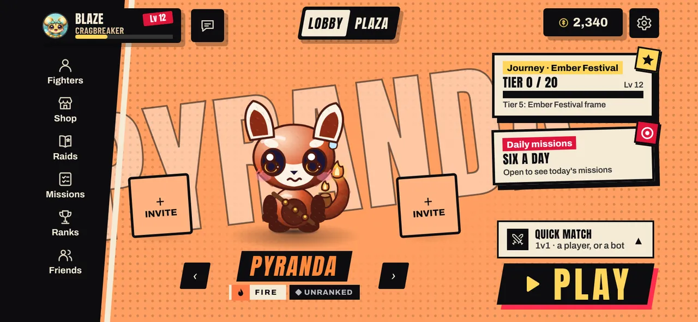
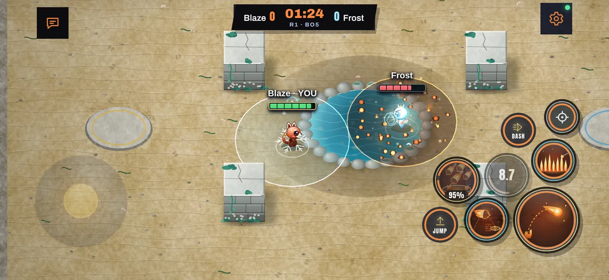
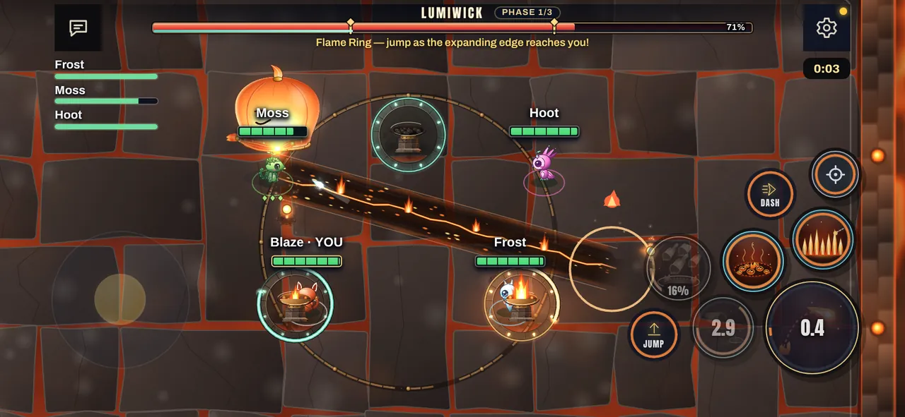
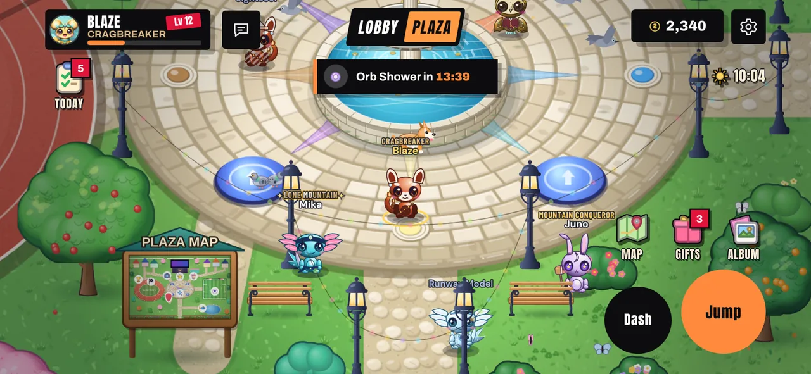
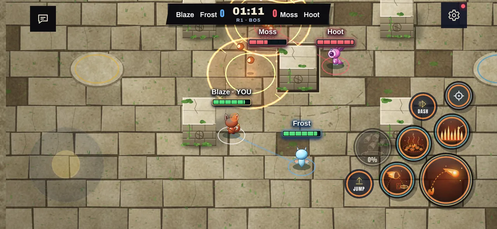

# Element Arena

**Real-time creature battles with friends: duel, team up, climb the Spire and take down giant raid bosses together.**

### [▶ Play now at play.elementarenausa.com](https://play.elementarenausa.com)

Free in your browser, on a phone (best in landscape) or a computer, in open beta: we're still adding and polishing, and your progress carries over through every update. More about the game at [elementarenausa.com](https://elementarenausa.com). News and clips: [@elementarena.usa on Instagram](https://www.instagram.com/elementarena.usa/).

<p align="center">
  
  
</p>
<p align="center">
  
  
</p>

## What's in the game

- **18 original fighters across 9 elements**: Electric, Fire, Water, Aura, Light, Psychic, Earth, Shadow and Nature, two of each, every one with its own kit of a basic attack, three skills and an ultimate, and its own way of walking on and of celebrating a win.
- **Duels**: best-of-five 1v1 against a player or a bot (Easy, Normal or Hard), from Quick match or a private room with a code.
- **2v2 teams and free-for-all**: team up with a friend, or fight three or four players at once; bots fill the empty seats when you search alone. Hosts of private rooms can turn on party rules like Turbo, Glass cannon or Crown Hill.
- **Co-op raids**: 1 to 4 players against seven giant bosses, each with its own phases, attacks to read and dodge, and cosmetic rewards.
- **The Spire**: a 70-floor climb for up to 4 players in seven zones, each with an elite halfway up and an Ascendant raid boss at the top.
- **The Plaza**: a shared playground for up to 40 players: bounce pads, a stage, a ball pitch, a dash track, a photo spot, gifts and daily quests. Players wear their title over their name, and the harder the title was to earn (Common to Mythical), the more special it looks.
- **Shop and cosmetics**: hundreds of champion skins in five rarities and themed collections, bought with coins you earn by playing.
- **Missions, levels and ranks**: daily missions, player levels 1 to 100 with a seasonal reward journey, a rank road to climb, achievements, titles and mastery badges.
- **Friends**: friend codes, invites, chat, and watching a friend's match live.

<p align="center">
  
</p>

The [player guide](docs/player-guide.md) has the details: rooms and modes, party rules, controls for keyboard, controller and touch, raids, the Plaza and the Shop.

## For developers

Element Arena is a TypeScript monorepo: a [Phaser](https://phaser.io) client built with Vite (`apps/client`), an Express and Socket.IO game server that runs every match (`apps/server`), the rules both share (`packages/shared`), the website (`apps/site`), and a Supabase database for accounts and progress (`supabase/migrations`).

### Run it locally

You need Node.js 22 or newer.

```bash
npm install
npm run dev
```

Open http://localhost:5173 (Vite forwards the game server on port 3001). Signing in needs a Supabase project: see [account setup](docs/accounts-setup.md). Then check your work with:

```bash
npm run typecheck
npm test
npm run build
```

Production builds, the visual tests, asset scripts and development previews are in [development](docs/development.md).

### Docs

The [docs index](docs/README.md) lists every document with one line each. The ones to read first:

- [Development](docs/development.md): running, building, checks, previews and known limits.
- [Player guide](docs/player-guide.md): how every mode and screen works.
- [Balance notes](docs/balance-notes.md): the history of every balance pass, and why the numbers are what they are.
- [Boss Raid](docs/boss-raid.md) and [the Spire](docs/spire-content-guide.md): raids, bosses and adding Spire content.
- [The game's look: Poster](docs/ui-themes.md): the one look every player has, and where its styles live.
- [Networking and battle performance](docs/network-performance.md): the protocol, and keeping battles smooth on older phones.
- [Removed features](docs/removed-features.md): what the game no longer has (the Farm, the Bistro, Gold Leaves and more), kept for the record.

### Contributing and AI agents

This repository is run day to day by AI coding sessions. Before you change anything, read:

- [CLAUDE.md](CLAUDE.md): the rulebook: the screenshot check for UI changes, how to run tests quickly, battle performance budgets, database migrations and the fast and full merge lanes.
- [AGENTS.md](AGENTS.md): what differs for Codex and other agents, and what the game no longer has.

`main` is production: a merge deploys the game, and a new file in `supabase/migrations/` runs on the live database.
