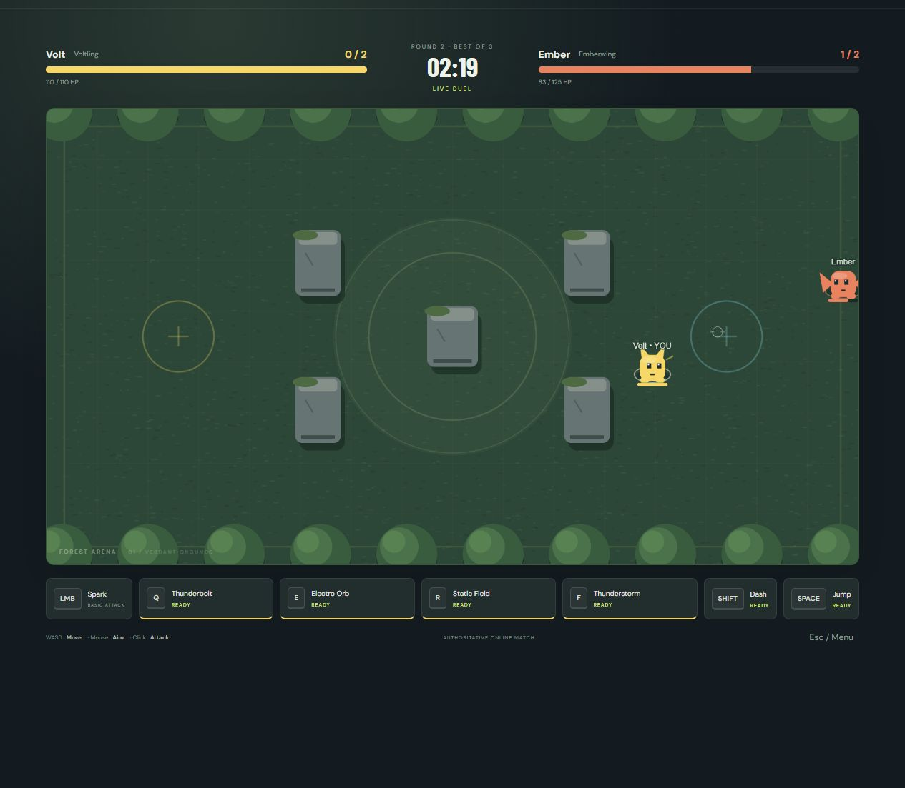

# Element Arena

A playable browser-based, real-time 1v1 creature fighting game. Both players move, aim, attack, dash and jump simultaneously. Pikachu, Charizard, Greninja, and Lucario use original SVG fan-art drawings with animated movement. This is an unofficial Pokémon fan project.

**Accounts are now required to play.** Follow [game account and admin setup](docs/accounts-setup.md) to create a separate Supabase project, apply the migration, configure auth, and grant your intended administrator. Solo testing and player/title management are admin-only. Email/password, Google sign-in, recovery, and Remember me follow the AMATYC project's pattern. Without account configuration you can browse creatures, but gameplay stays locked.



## Run locally

Use Node.js 22 LTS or newer and npm. Open this folder in VS Code, then run:

```sh
npm install
npm run dev
```

Open **http://localhost:5173**. Vite serves the client and proxies `/socket.io` and `/api` to the server on port 3001. Create a room with a display name, share its six-character code, choose creatures, and click Ready on both clients.

```sh
npm run typecheck
npm run test
npm run build
npm run start
```

Production is available at **http://localhost:3001** after building. One Express service serves both the compiled frontend and Socket.IO. Start commands must run from the repository root.

## Play with two players

**Two browser windows:** open two ordinary tabs or windows at the same URL. Each tab stores its own session token in `sessionStorage`, so players can coexist and reconnect independently. Name each player, create a room in one, and join it in the other. Avoid duplicating an existing lobby tab because some browsers copy session storage when duplicating tabs. Focus the game window to move; inactive windows send neutral input.

**Two computers on your local network:** run `npm run dev` on the host. Find its LAN IPv4 address with `ipconfig`, then open `http://HOST_LAN_IP:5173` on both computers. Both devices must be on the same network, and the host's firewall must allow the Vite port on that private network. `localhost` on your friend's device points to their device, not yours. Vite proxies sockets so only the frontend port needs to be reached by the friend. You can also build and start, then access `http://HOST_LAN_IP:3001` on the LAN.

**Across the internet:** deploy the single service below and give both players the same HTTPS public URL. LAN addresses do not work over the public internet. No peer-to-peer networking or router port forwarding is required. Supabase stores accounts, permissions and titles; battle rooms remain in server memory.

## Controls and rules

### Solo test mode

Sign in as an administrator, select a creature and click **Solo test mode** on the main menu. No second player or ready step is needed. Practice uses the same authoritative combat as online matches, without a round timer. Both you and the training target respawn automatically when defeated.

The practice toolbar lets you switch between all four creatures, reset health/positions/statistics, turn off skill/dash/jump cooldowns, and enable target attacks. The target shoots projectiles and places ground fire so you can test Counter Stance, Water Clone and jump dodges. Cast and recovery times still apply with cooldowns disabled. Hover the skill buttons for descriptions. Switching creatures resets the arena. Solo mode still needs the local or deployed game server running.

| Input            | Action                                      |
| ---------------- | ------------------------------------------- |
| WASD             | Move; diagonal movement is normalized       |
| Mouse            | Aim                                         |
| Left click, hold | Basic attack                                |
| 1 / 2 / 3 / RMB  | Three skills + right-click ultimate         |
| Left Shift       | Dash, 3-second cooldown; walls still block  |
| Space            | Jump, 2-second cooldown; avoid ground zones |
| Escape           | Settings; online matches continue           |

Best of three rounds, three minutes per round. Health and cooldowns reset each round. Timeout compares health **percentages**, with health-draining overtime on a tie. Simultaneous knockouts draw the round. Dash grants no invulnerability. Airborne players can still be hit by projectiles. Cover blocks projectiles and melee line of sight. Zones tick every half second. Counter Stance reduces and reflects damage, and Water Clone absorbs one projectile and grants haste.

Four creatures: Voltling (fast electric ranged fighter), Emberwing (fire and rush attacks), Aquashade (water assassin and decoy), and Auralith (energy, melee and counter). Each has exactly four equipped skills, plus a separate basic attack, dash and jump. Balance is provisional.

## Architecture

- `packages/shared/src/index.ts`: strict protocol schemas, characters, ability definitions, map, constants, and shared collision/movement helpers.
- `apps/server/src/simulation.ts`: deterministic fixed-step authoritative combat and round state machine. Reusable handlers cover projectiles, explosions, zones, melee, movement attacks, clone, counter, barrage and charged blasts.
- `apps/server/src/server.ts`: rooms, secure tokens, membership, rate/payload limits, lifecycle and Socket.IO synchronization.
- `apps/client/src/main.ts`: Phaser rendering, local movement prediction and reconciliation, remote smoothing, input sampling, lobby and HUD.
- `apps/client/src/networking/interpolation.ts`: bounded timestamp-based interpolation of remote movement.
- `apps/client/src/audio.ts`: original synthesized effects and music, unlocked by interaction, with independent volume settings.
- `tests/unit` and `tests/multiplayer`: simulation and real two-client Socket.IO integration tests.

Simulation runs at 30 ticks/sec, snapshots at 15/sec, rendering at the device frame rate. Inputs carry monotonically increasing sequence numbers. The client predicts movement using shared rules, drops acknowledged inputs and replays pending ones on authoritative snapshots. Remote movement uses a bounded timestamp buffer with a 100 ms interpolation delay. The client never submits damage or health. Snapshots contain dynamic fighters, projectiles, zones and bounded events; static map/character definitions are bundled rather than streamed. Room capacity, projectiles, zones and recent events are bounded. Effects destroy their objects after completion.

The server retains a disconnected slot for 30 seconds, suspends match simulation, and requires a cryptographic 256-bit bearer token to resume. A token cannot take over an already connected player. Expiry awards a forfeit when an opponent remains. Explicitly leaving forfeits immediately. Lobby disconnects reserve the slot until expiry. Empty rooms expire and are removed. Tokens stay per-tab; closing a tab may discard its token. Reopening a closed tab is not guaranteed to restore a session. Treat room codes as access codes, not authentication.

## GitHub and Render

Create a GitHub repository and push the project (excluding `.env` and build output). On Render, choose **New → Blueprint**, connect that repository and use the included `render.yaml`. Alternatively create one Node Web Service with:

- Build: `npm ci --include=dev && npm run build`
- Start: `npm run start`
- Health check: `/api/health`
- One instance; Node 22 LTS; `NODE_ENV=production`

The service binds `0.0.0.0` and uses Render's `PORT`. The client uses same-origin Socket.IO in production and supports `VITE_SERVER_URL` at build time for a deliberate separate origin. Optional `CLIENT_ORIGIN` restricts browser CORS when configured. Runtime `.env` is loaded from the root. `.env.example` lists settings; never commit secret values.

Render supports WebSockets on the same HTTP service port: [WebSocket documentation](https://render.com/docs/websocket). The Blueprint uses the HTTP endpoint described in [Render health checks](https://render.com/docs/health-checks). The sample selects the free plan for evaluation; an always-available server may require a paid instance. Hosting costs and idle behavior depend on the chosen plan. Review the current plan before deploying. Cold starts and deployments can interrupt active matches.

Rooms live in memory and **do not survive server restarts**. Keep a single instance. Horizontal scaling requires shared session/room state, suitable socket routing, and coordinated simulation ownership; adding a Socket.IO adapter alone is insufficient.

Git is initialized on `main`. To publish to a repository you own, replace the placeholder URL:

```sh
git add .
git commit -m "Build Element Arena multiplayer MVP"
git remote add origin https://github.com/YOUR_USER/YOUR_REPO.git
git push -u origin main
```

## Verification and practical limits

Verified locally on October 11, 2026: TypeScript checks, all 28 automated tests, production build/start, and the combined development command. Two real browser tabs joined a shared room, selected different creatures, started a round, moved around cover, cast skills, dashed, jumped, and resumed after reload. Browser-driven attacks reduced an opponent to 83/125 HP, with the same health shown in both tabs. The preview above comes from that live match. Public hosting and a two-physical-computer internet playtest have not been performed.

Automated tests exercise normalization, collision, projectiles, cooldowns, damage, dash, jump, statuses, charged skills, rounds and overtime, room capacity, invalid actions, mirrored movement/health, synchronized skill casts, match results, rematches, disconnects, secure reconnection, forfeit and room cleanup. Network tests use two real socket clients and step the server deterministically; health is lowered by test fixtures to exercise death without waiting several minutes.

This MVP uses procedural artwork and synthesized music/effects. It supports desktop keyboard/mouse play and responsive layout, with no mobile touch controls. Prediction currently covers movement and universal dash, not combat outcomes. Internet latency/balance testing with two humans is still necessary. Ranked matchmaking, saved match stats, remappable controls, additional maps, sprite-sheet animations, and advanced unused ability categories (homing/beam attacks) are future work.

## Troubleshooting

- If installation cannot reach npm, check network/proxy settings, then retry `npm install`. Keep `package-lock.json` for repeatable deployment.
- If the lobby says connecting, confirm the backend runs on 3001 and Vite on 5173, or use `npm run build` followed by `npm run start` for same-origin production.
- If another computer cannot connect, use the host LAN IP, check firewall rules and Wi-Fi client isolation. Do not use `localhost` on the second device.
- If a room is full after disconnect, reconnect in the original tab within 30 seconds, wait for expiry, or create a new room. A token is only valid on its original server process.
- Browser sound starts after a click due to autoplay rules. Change Music and Sound Effects in Settings.
- A build size warning reflects the Phaser runtime. It does not prevent production build or play; further code splitting/loading optimization can follow the MVP.

Mobile controls turn on automatically for coarse-pointer devices. Use Mobile fullscreen on the homepage or confirm the pre-match instructions to request fullscreen from a tap. The left joystick moves; right buttons attack, cast skills, dash and jump. Mobile aim follows the opponent. Fullscreen availability depends on the browser. A development-only control demo is available at `/touch-preview.html` while running Vite.

See [Mobile controls and PWA setup](docs/mobile-pwa.md) for installation, deployment, customization, and validation limitations.
