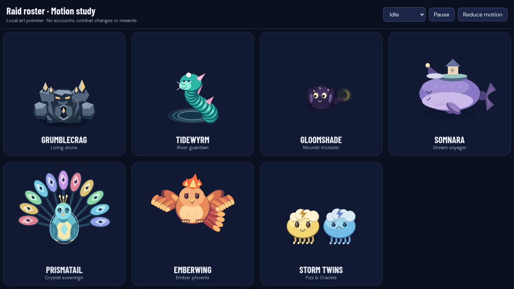

# Boss animation and design pass

Client-only changes to all seven raid bosses. No server/shared/database changes, gameplay timing changes, warning radii changes, hitbox changes or new network fields. Bosses remain at their authoritative world positions.

| Boss        | Presentation changes                                                                                                                                                                                                                              |
| ----------- | ------------------------------------------------------------------------------------------------------------------------------------------------------------------------------------------------------------------------------------------------- |
| Grumblecrag | Heavy blinking stone lids, breathing shoulder plates, smoother gaze and a charge stance that freezes correctly during pauses. Existing slam, pillar crash and collapse poses remain.                                                              |
| Tidewyrm    | Blinking, jaw anticipation, trailing barbels and a recoiling neck. Existing swimming coils, stranding, surfacing and splashes remain.                                                                                                             |
| Gloomshade  | Squashing shadow body, hinged floppy ears, blinking main eyes and casting expression. Copies share the added expression; the existing shadow and crescent-tail tells remain the only intentional differences.                                     |
| Somnara     | Swimming tail flukes, independently stroking flippers, pleated throat, pendulum nightcap, sleepy/waking eyes and a singing mouth. The cottage has warm divided windows. The existing 250×144 body silhouette and same-seed retry behavior remain. |
| Prismatail  | Overlapping faceted eye feathers instead of rigid spokes, a breathing fan, hinged wings, tilting head, moving crown tips and blinking eyes. Planted feet keep the pose grounded.                                                                  |
| Emberwing   | Hinged shoulders, delayed primary feathers, layered tail plumes, licking crest flames, blinking eyes and a casting beak. The existing flight-to-ground transition remains.                                                                        |
| Storm Twins | Contracting jelly bells, lagging segmented tendrils, independently billowing cloud caps and distinct alert/sleepy expressions. Each twin has its own blink cycle.                                                                                 |

The shared cosmetic clock advances continuously between network snapshots, caps catch-up after slow frames, smooths gaze, pauses without advancing cycles, and resets on a new run or same-seed retry. Casting poses use existing live warnings, including caster identity for the twins. Cancelled/future warnings do not create new casting cues. No new audio triggers are introduced.

Reduced motion disables breathing, blinking, ripples in the added limbs and idle oscillation. Casting uses a steady anticipation pose; victory has a settled static alternative. Tidewyrm and Gloomshade's existing clocks also freeze during pauses and reset on retries.

The art uses bounded loops and the existing Phaser graphics layer, with no new image downloads, DOM animation loops, blur filters or particle systems. One local headless Canvas sample generated body commands in roughly 0.02–0.18 ms per boss; this is a command-generation sample, not a real-device frame-rate guarantee.

## Local review

Run `npm run dev`, then open:

- `/boss-animation-preview.html`: all seven bosses, with idle/casting/exposed/defeated states, pause and reduced-motion controls. Add `?boss=emberwing` (or another boss ID) for one large portrait.
- `/raid-preview.html`: the existing playable local raid test now includes a boss selector. Add `?boss=prismatail&touch=1` to review a specific boss with touch controls. No accounts or rewards are involved.

Both pages are development previews and are excluded from the production build.

## Validation

- `npm run typecheck`
- `npm test -- --maxWorkers=2`: 948 existing tests, including boss simulations, warning rendering and Somnara's same-seed retry.
- `npm run test:boss-art -w apps/client`: 26 focused frontend tests for continuous clocks, warning selection, pause/resume, gaze, short blinks, finite drawing geometry, balanced transforms, snapshot immutability and static reduced-motion alternatives for all seven bosses.
- `npm run build -w apps/client` and `node scripts/verify-pwa.mjs`.
- Browser review of every boss in the local arena at 1280×720 and 844×390 with touch controls, plus all four gallery states and a pixel comparison confirming a static reduced-motion gallery.
- Prettier on changed files; repository-wide formatting still reports pre-existing issues elsewhere.
