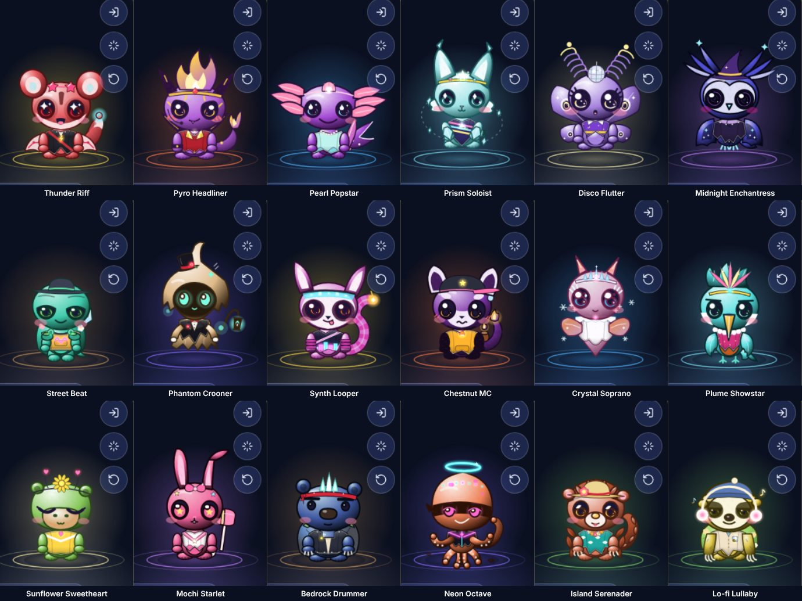
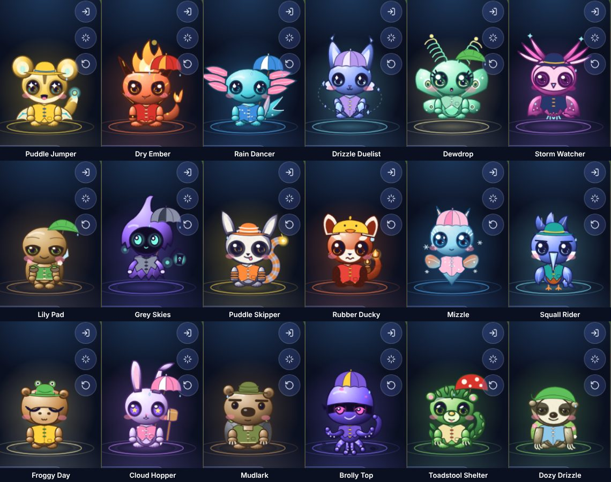
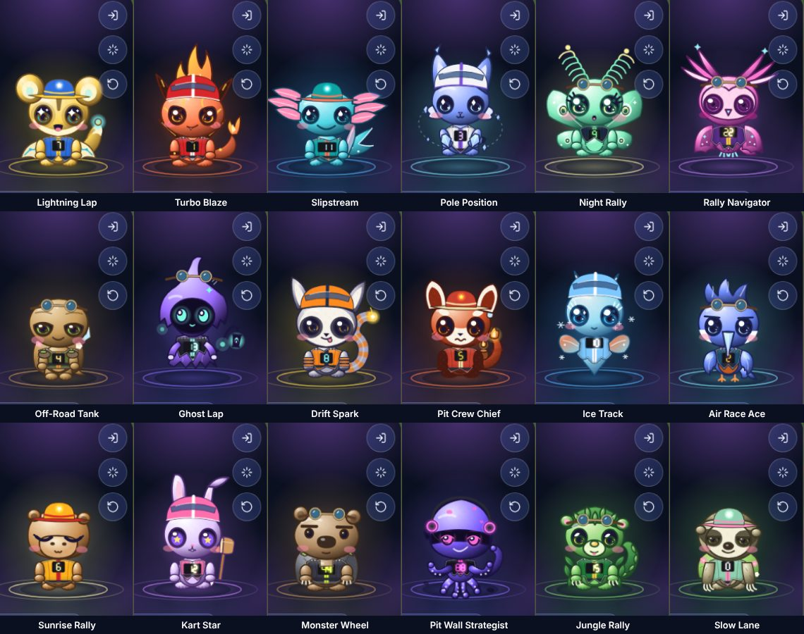
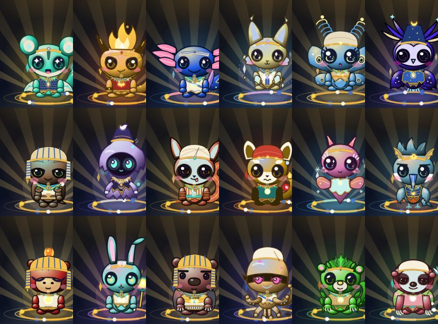
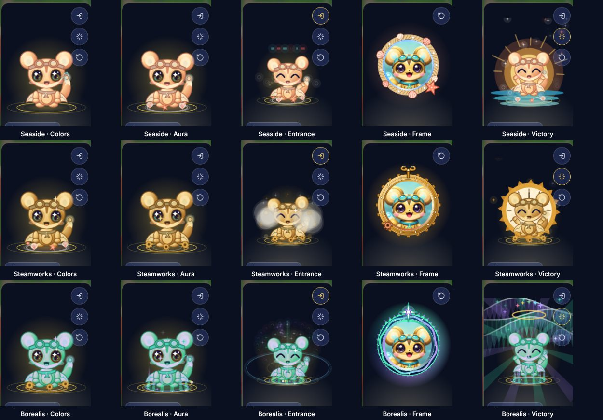
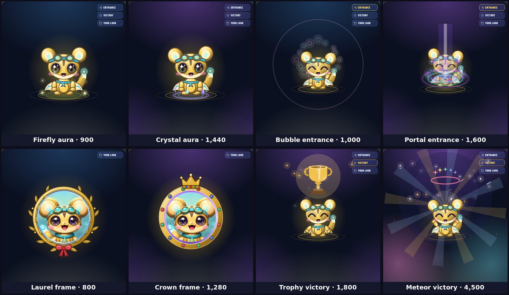
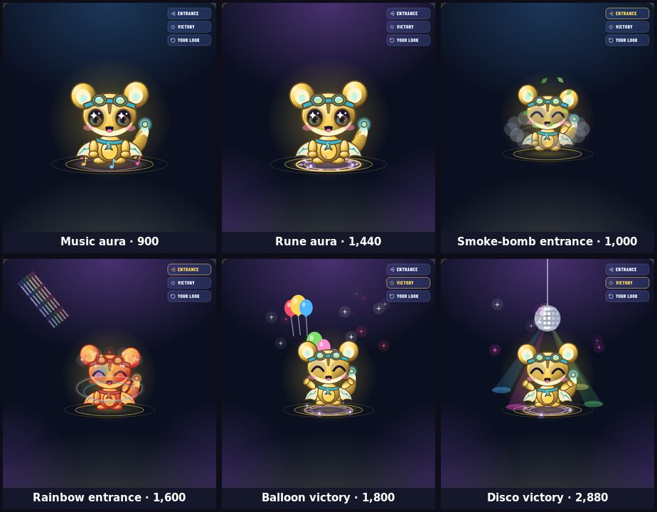
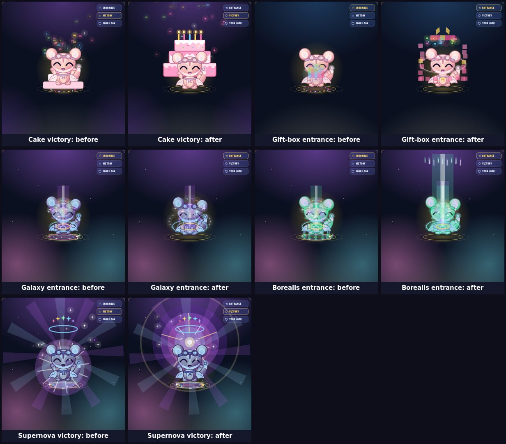
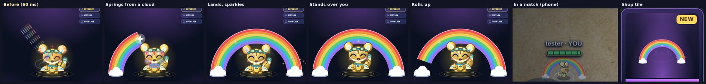

# New Shop skins and items (from 25 Nov 2026)

The owner asked for many more skins and items to sell, in every rarity and
every kind, varied and attractive (25 Nov). This is the plan, the prices and
the rules every new item follows. One collection ships per pull request,
complete: catalog, art, frame, seed migration, tests, screenshots.

## Rules before anything is added

1. **New items stay out of Today's Picks until opened.** Today's Picks draws
   from every item on sale, and an app built before an item existed cannot
   draw its tile (the iOS app carries its own copy of the game). Migration
   `20261125120000_shop_picks_opt_in.sql` adds `arena_shop_items.in_picks`,
   false for every new row. A catalog migration therefore needs nothing
   extra: its items sell in the Shop's tabs at once and are never a pick.
   **To open a collection**, add a migration with
   `update public.arena_shop_items set in_picks = true where collection = '<id>' and kind <> 'bundle';`
   once (a) the client that skips picks it doesn't know is released on the
   web and in the App Store build, and (b) the collection has been in that
   release. `tests/integration/shop-picks-opt-in.test.ts` covers both sides.
2. **Ids are never a reward's id.** Journey, season, raid and collection
   reward items live in the same tables and slots; the seed is an upsert.
   `tests/unit/shop-reserved-ids.test.ts` fails on a clash, and the
   integration test checks no reward or retired row was overwritten. Ids
   never change once they are in production.
3. **A Look set's collection id is its own.** `arena_collection_bonus` gives
   a collection's frame for free to whoever owns all of that collection's
   champion skins (Winter, Festival...). A new Look set only shares an id
   with a skin collection when that gift is intended.
4. **The startup script stays under its limit**: 2,400,000 bytes, which
   `scripts/verify-pwa.mjs` enforces in CI (#443); code only a battle needs
   loads through `battle-kit.ts`. Main was 1,609,089 bytes on 25 Nov; with
   every collection here (#434 to #473) it is 1,685,395 (+76 KB). Every pull
   request states the size before and after, and a chain of them growing it
   by more than about 300 KB is talked over with the performance work first.
   The limit is not raised.

## Prices

Unchanged ladder, in coins. Median income is about 310–440 coins per day
played (`docs/economy-review.md`), so a rarity is a number of days:

| Rarity    | Skin  | About             | What the price buys (`tests/unit/skin-art.test.ts`)            |
| --------- | ----- | ----------------- | -------------------------------------------------------------- |
| Common    | 500   | 1–2 days          | A new palette                                                  |
| Rare      | 1,500 | 4–5 days          | A costume or pattern, a dash trail; nothing drawn at rest      |
| Epic      | 3,500 | 8–11 days         | A full costume with pieces that light up, skill colour, trail  |
| Legendary | 5,500 | 13–18 days        | Its own signature effect, landing, victory, gold-edged costume |
| Mythical  | 8,000 | 3 weeks + 30 wins | Void Knights only (three Awakening forms); no new ones here    |

Look pieces keep `LOOK_SLOTS` × the set's tier (1, 1.6, 2.5); a set is 80% of
what you don't own. No real-money price is set or changed here.

## Collections

Themes are original and far from the ones on sale (Wayfarer, Moonlit Tea,
Astral Court, Abyssal Expedition, Hero Squad, Neon Campus, Cyber Mecha, Nova
Vanguard, Sky Pirates, Hồn Việt, Stars & Stripes, Void Knight, Arcade,
Winter, Festival, Garden, Candy, Retro Pixel, Galaxy).

| #   | Collection         | Kind             | Rarity / price                              | Why                                                                                                                                         |
| --- | ------------------ | ---------------- | ------------------------------------------- | ------------------------------------------------------------------------------------------------------------------------------------------- |
| 1   | **Starlight Idol** | 18 skins + set   | Epic / 3,500                                | Five designs were already drawn; a stage act per champion (rock, pop, ballad, DJ...), sequins and stage lights are what lume layers do best |
| 2   | **Seaside**        | Look set (5)     | Tier 0: 300 / 900 / 1,000 / 800 / 1,800     | A sunny entry-price set: no summer theme exists yet                                                                                         |
| 3   | **Steamworks**     | Look set (5)     | Tier 1: 480 / 1,440 / 1,600 / 1,280 / 2,880 | Brass gears and steam: a mechanical look that is not sci-fi                                                                                 |
| 4   | **Borealis**       | Look set (5)     | Tier 2: 750 / 2,250 / 2,500 / 2,000 / 4,500 | The second showcase set beside Galaxy: curtains of northern light                                                                           |
| 5   | **Birthstone**     | 18 skins + set   | Common / 500                                | A gem palette per champion: a cheap first purchase for every champion                                                                       |
| 6   | **Rainy Day**      | 18 skins + set   | Rare / 1,500                                | Raincoats, boots and umbrellas: cosy, readable silhouettes, a droplet trail                                                                 |
| 7   | **Grand Prix**     | 18 skins + set   | Epic / 3,500                                | Racing suits and helmets with lit numbers: speed suits a dash trail                                                                         |
| 8   | **Sun Dynasty**    | 18 skins + set   | Legendary / 5,500                           | A desert kingdom in gold and lapis: gold is the Legendary finish                                                                            |
| 9   | **Singles**        | 8 pieces, no set | Tier 0–2: 800 to 4,500                      | A theme of its own each, priced like a set's piece of its slot and tier; a Singles chip after the sets in Collections                       |

Shipped, all merged on 25 Nov: 1 (migration
`20261125130000_starlight_idol.sql`); 2–4 (migration
`20261125140000_seaside_steamworks_borealis.sql`); 5 (migration
`20261125150000_birthstone.sql`); 6 (migration `20261125160000_rainy_day.sql`); 7 (migration
`20261125170000_grand_prix.sql`); 8 (migration `20261125180000_sun_dynasty.sql`).
All eight collections and Singles (9) were opened to Today's Picks by
`20261126004500_open_new_picks.sql`, since #435 was live on the web and no App
Store build existed yet; the owner asked for Singles at once too, since nobody
plays yet. Their set bundles stay out, as every bundle does.

Sun Dynasty is the fifth Legendary set, built the way the other four are:
a body in two tones (`SUN_TINTS` and `LEGEND_SECOND`, every body at least
26 ΔE from the champion's other ones), a costume per champion
(`modern-sun.ts`: the court's broad bead collar, a pectoral of its trade,
headwear of its rank) edged in gold with a sun clasp, and a signature table
(`epic-signature-fx.ts`, `sun`): a motif per champion summoned by the
ultimate, a gold-sand trail, a sun-mosaic landing and a winged-sunrise
victory, inside the same drawing budget. The Moon Vizier's lantern becomes
a brass lamp, the Spice Healer's chestnut a pomegranate and the Lotus
Sceptre's mallet a gold sceptre crowned with a sun.

The three Look sets keep their portrait CSS (frame art, the small pictures of
the other pieces) in the generated `collection-frames.css`
(`scripts/frame-art.mjs`), not in `style.css`.

Mythicals stay one per champion (the Void Knights): each has a Mythic Trial
and three Awakening forms, and a second line would be a design decision of
its own, not catalog growth.

### Singles (9)

Look pieces sold one at a time, outside any set: collection `singles`, no
bundle. The first eight (migration `20261125200000_look_singles.sql`) were
seeded out of Today's Picks and opened with the sets; the six of 26 Nov
(`20261126023000_more_singles.sql`) went straight in, as the owner asked while
nobody plays yet. Each is priced like a set's piece of the same slot and
tier, so a single never undercuts a set:

| Piece               | Slot     | Tier | Rarity   | Price | What it does                                   |
| ------------------- | -------- | ---- | -------- | ----- | ---------------------------------------------- |
| Firefly aura        | aura     | 0    | Rare     | 900   | Fireflies drift round you, blinking gold       |
| Crystal aura        | aura     | 1    | Epic     | 1,440 | Violet crystals orbit you and catch the light  |
| Bubble entrance     | entrance | 0    | Rare     | 1,000 | Float in inside a bubble that pops             |
| Portal entrance     | entrance | 1    | Epic     | 1,600 | Step out of a swirling portal                  |
| Laurel frame        | frame    | 0    | Rare     | 800   | A wreath of gold laurel leaves                 |
| Crown frame         | frame    | 1    | Epic     | 1,280 | A jewelled ring under a gold crown             |
| Trophy victory      | victory  | 0    | Epic     | 1,800 | A gold trophy rises in a shower of sparkles    |
| Meteor victory      | victory  | 2    | Mythical | 4,500 | Meteors streak across the sky behind you       |
| Music aura          | aura     | 0    | Rare     | 900   | Music notes bob round you to the beat          |
| Rune aura           | aura     | 1    | Epic     | 1,440 | A circle of glowing runes turns beneath you    |
| Smoke-bomb entrance | entrance | 0    | Rare     | 1,000 | Ninja smoke rolls out low, leaves whirl up     |
| Rainbow entrance    | entrance | 1    | Epic     | 1,600 | A rainbow arches over you from cloud to cloud  |
| Balloon victory     | victory  | 0    | Epic     | 1,800 | Balloons float up behind you                   |
| Disco victory       | victory  | 1    | Epic     | 2,880 | A disco ball spins, its lights sweep the floor |

The themes stay clear of the sets and of reward pieces (the journey's comet
arrival is why the portal is not a comet). `arena_collection_bonus` gives a
collection's frame only for owning its champion skins, and Singles has none,
so no frame comes free.

A Mythical Look piece is a rarity by price, not a Mythical skin: the Mythic
Trial (30 wins with the champion) is for Void Knight skins only
(`20261125193000_mythical_look_pieces.sql`; before it, Galaxy's and
Borealis's Mythical pieces could not be bought on their own).

## Effects review (26 Nov)

Every aura, entrance and victory on sale was played on the Shop's stage
frame by frame (80 ms to 2.3 s) and compared. Fixed:

- **Entrances kept within the rig's particles.** A fighter's rig keeps 48
  particles and drops the oldest for each new one (`rig.ts`
  `MAX_PARTICLES`). A Mythical entrance's rarity flourish alone is 50, and it
  comes after the piece's own burst, so Galaxy's star tunnel and Borealis's
  light ribbons never showed and the two looked the same; Candy's gift box
  and Festival's firecrackers lost their first pieces too.
  `playCollectionEntrance` now fits each burst into `ENTRANCE_BUDGET` (48):
  shockwaves, pillars and rings always stay, the rest is thinned evenly, the
  piece's own burst ahead of its flourish (`tests/unit/entrance-budget.test.ts`
  replays the rig's queue). New entrances are drawn within the budget.
- **Candy's cake** stood below the fighter's feet and read as a pink step in
  front of it: now a three-tier cake behind the fighter, its base hidden by
  the feet, its candles lit above the head.
- **Entrances that read as a blur over the body** now show their theme: a
  pink gift box tied in gold bursting apart (Candy), pixels dropping into a
  blocky beam (Retro), firecrackers popping in a ring round the fighter
  (Festival), a flower opening at the feet (Garden). Particles start on the
  outline or around the fighter, not over the face, and big pieces carry no
  halo (`glow: false`).
- **Steamworks' steam** starts beside the fighter and rolls outward, so the
  body stays clear.
- **Galaxy**: the supernova sits above the head, with a white-gold core
  flash, a shell of violet, pink and ice blue, a shock ring and streaks (it
  used to tint the fighter the same violet as Galaxy colours); its aura
  gains nebula clouds and two small worlds in orbit.
- **Borealis's aura**: its curtains stand taller beside and behind the
  fighter, and short on the near half so the light never veils its body.

## Rainbow entrance (26 Nov)

The owner found the Rainbow entrance plain ("chưa đặc biệt lắm"): a ribbon of
streaks that crossed the fighter in about 0.2 s. Particles alone cannot draw
an arch (each one flies in a straight line, and an entrance gets 48), so the
Rainbow now draws as well as bursting, as finales do:

- a six-band rainbow springs out of a cloud beside the fighter, arcs over
  its head and lands on a second cloud with a ring and sparkles in every
  colour;
- it stands for a second with a sheen running along it and stars
  twinkling on the bands, then rolls up into the far cloud and the clouds
  puff away (2.15 s in all);
- the burst under it is a rainbow ripple at the feet and stars in the
  bands' colours fountaining up round the body.

Everything stands on the floor and draws behind the fighter. Entrances that
draw are listed in `DRAWN_ENTRANCES` (`collection-fx.ts`): how long they
draw, the room a thumbnail gives them (the arch is wider than the usual
entrance frame) and the moment a catalogue tile shows. The rig draws them
while the fighter greets, the Shop's stage and thumbnails through the same
code, and the Plaza for you and the nearest players, like a finale.

On a phone's Shop stage (667 to 852 wide) the stage is narrower than the
arch, so its feet and clouds are cut at the sides; the tile, a match and a
desktop stage show all of it. `tests/unit/drawn-entrance.test.ts` checks
the arch's timing, that it fits its tile and that the Plaza draws and stops
it; `new-collections` checks that the green band spans the tile and the
stage at every review size.
