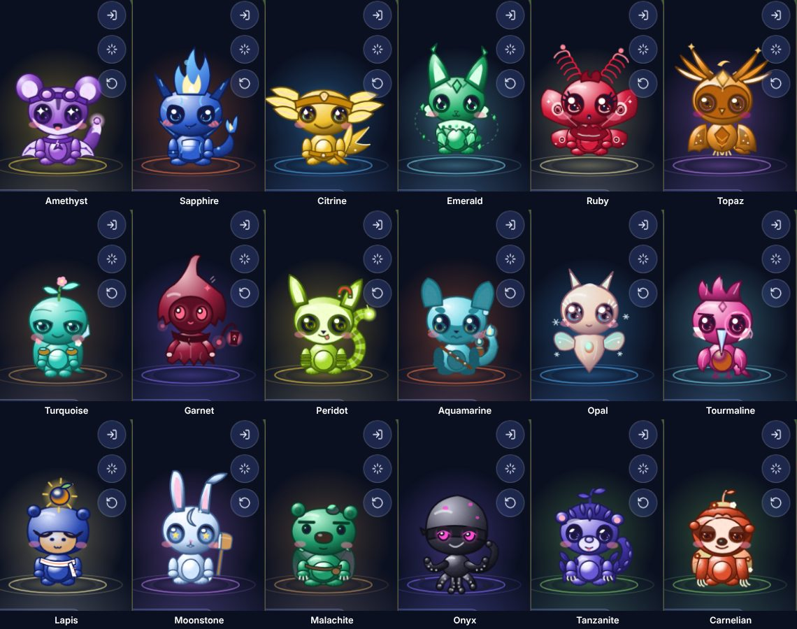

# New Shop skins and items (from 25 Nov 2026)

The owner asked for many more skins and items to sell, in every rarity and
every kind, varied and attractive (25 Nov). This is the plan, the prices and
the rules every new item follows. One collection ships per pull request,
complete: catalog, art, frame, seed migration, tests, screenshots.

## Rules before anything is added

1. **New items stay out of Today's Picks until opened.** Today's Picks draws
   from every item on sale, and an app built before an item existed cannot
   draw its tile (the iOS app carries its own copy of the game). Migration
   `20261125120000_shop_picks_opt_in.sql` adds `arena_shop_items.in_picks`,
   false for every new row. A catalog migration therefore needs nothing
   extra: its items sell in the Shop's tabs at once and are never a pick.
   **To open a collection**, add a migration with
   `update public.arena_shop_items set in_picks = true where collection = '<id>' and kind <> 'bundle';`
   once (a) the client that skips picks it doesn't know is released on the
   web and in the App Store build, and (b) the collection has been in that
   release. `tests/integration/shop-picks-opt-in.test.ts` covers both sides.
2. **Ids are never a reward's id.** Journey, season, raid and collection
   reward items live in the same tables and slots; the seed is an upsert.
   `tests/unit/shop-reserved-ids.test.ts` fails on a clash, and the
   integration test checks no reward or retired row was overwritten. Ids
   never change once they are in production.
3. **A Look set's collection id is its own.** `arena_collection_bonus` gives
   a collection's frame for free to whoever owns all of that collection's
   champion skins (Winter, Festival...). A new Look set only shares an id
   with a skin collection when that gift is intended.
4. **The entry script stays under the precache limit** (3 MiB,
   `apps/client/vite.config.ts`). It was 2,731,389 bytes (86.8%) on 25 Nov.
   Every pull request states the size before and after; past 2,950,000
   bytes the skin art is split into a lazily loaded chunk before more is
   added. The limit is not raised.

## Prices

Unchanged ladder, in coins. Median income is about 310–440 coins per day
played (`docs/economy-review.md`), so a rarity is a number of days:

| Rarity    | Skin  | About             | What the price buys (`tests/unit/skin-art.test.ts`)            |
| --------- | ----- | ----------------- | -------------------------------------------------------------- |
| Common    | 500   | 1–2 days          | A new palette                                                  |
| Rare      | 1,500 | 4–5 days          | A costume or pattern, a dash trail; nothing drawn at rest      |
| Epic      | 3,500 | 8–11 days         | A full costume with pieces that light up, skill colour, trail  |
| Legendary | 5,500 | 13–18 days        | Its own signature effect, landing, victory, gold-edged costume |
| Mythical  | 8,000 | 3 weeks + 30 wins | Void Knights only (three Awakening forms); no new ones here    |

Look pieces keep `LOOK_SLOTS` × the set's tier (1, 1.6, 2.5); a set is 80% of
what you don't own. No real-money price is set or changed here.

## Collections

Themes are original and far from the ones on sale (Wayfarer, Moonlit Tea,
Astral Court, Abyssal Expedition, Hero Squad, Neon Campus, Cyber Mecha, Nova
Vanguard, Sky Pirates, Hồn Việt, Stars & Stripes, Void Knight, Arcade,
Winter, Festival, Garden, Candy, Retro Pixel, Galaxy).

| #   | Collection         | Kind                                           | Rarity / price                              | Why                                                                                                                                         |
| --- | ------------------ | ---------------------------------------------- | ------------------------------------------- | ------------------------------------------------------------------------------------------------------------------------------------------- |
| 1   | **Starlight Idol** | 18 skins + set                                 | Epic / 3,500                                | Five designs were already drawn; a stage act per champion (rock, pop, ballad, DJ...), sequins and stage lights are what lume layers do best |
| 2   | **Seaside**        | Look set (5)                                   | Tier 0: 300 / 900 / 1,000 / 800 / 1,800     | A sunny entry-price set: no summer theme exists yet                                                                                         |
| 3   | **Steamworks**     | Look set (5)                                   | Tier 1: 480 / 1,440 / 1,600 / 1,280 / 2,880 | Brass gears and steam: a mechanical look that is not sci-fi                                                                                 |
| 4   | **Borealis**       | Look set (5)                                   | Tier 2: 750 / 2,250 / 2,500 / 2,000 / 4,500 | The second showcase set beside Galaxy: curtains of northern light                                                                           |
| 5   | **Birthstone**     | 18 skins + set                                 | Common / 500                                | A gem palette per champion: a cheap first purchase for every champion                                                                       |
| 6   | **Rainy Day**      | 18 skins + set                                 | Rare / 1,500                                | Raincoats, boots and umbrellas: cosy, readable silhouettes, a droplet trail                                                                 |
| 7   | **Grand Prix**     | 18 skins + set                                 | Epic / 3,500                                | Racing suits and helmets with lit numbers: speed suits a dash trail                                                                         |
| 8   | **Sun Dynasty**    | 18 skins + set                                 | Legendary / 5,500                           | A desert kingdom in gold and lapis: gold is the Legendary finish                                                                            |
| 9   | Single pieces      | Auras, frames, entrances, victories sold alone | By slot and tier                            | Needs a place in the Collections screen (the Shop screens' session)                                                                         |

Shipped (none yet in Today's Picks): 1 (migration
`20261125130000_starlight_idol.sql`); 2–4 (migration
`20261125140000_seaside_steamworks_borealis.sql`); 5 (migration
`20261125150000_birthstone.sql`).

The three Look sets keep their portrait CSS (frame art, the small pictures of
the other pieces) in the generated `collection-frames.css`
(`scripts/frame-art.mjs`), not in `style.css`.

Mythicals stay one per champion (the Void Knights): each has a Mythic Trial
and three Awakening forms, and a second line would be a design decision of
its own, not catalog growth.
