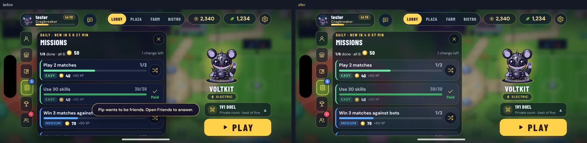
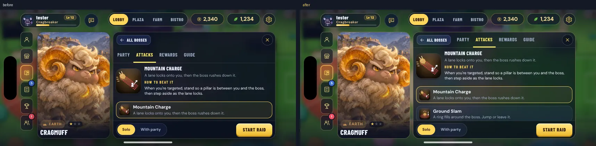
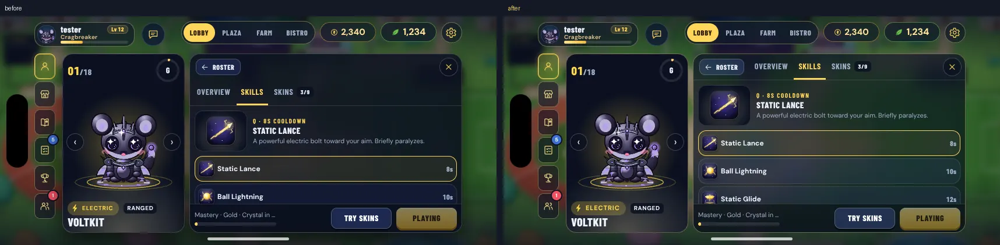
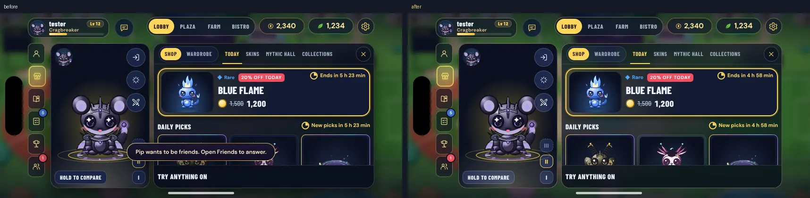
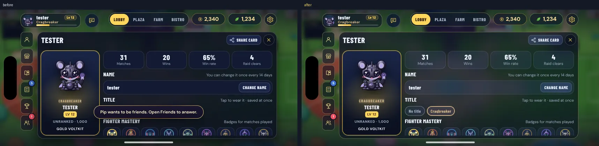
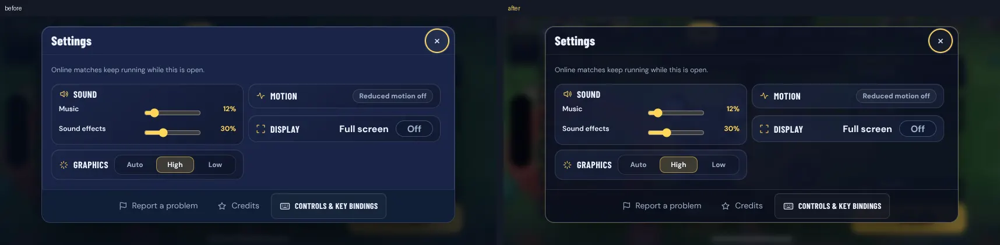
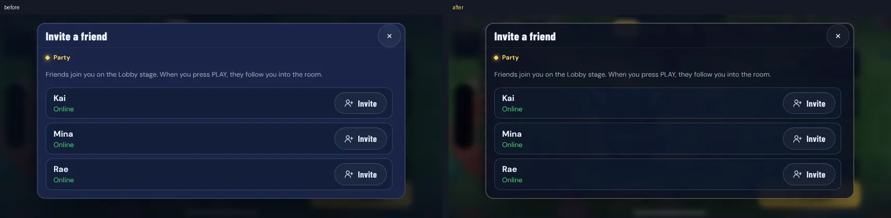
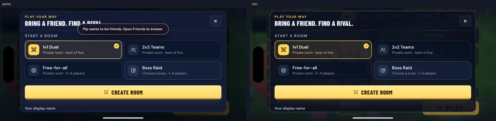

# One glass look, and a phone pass before the App Store (16 Nov 2026)

The owner's request: before release, review every panel, tab and text for
phones (the game was built for desktop first), and use the Lobby's
see-through "aero" glass everywhere, defined in **one place** so that one
edit changes the whole game.

This file covers what was found, what changed, how the glass system works,
and what is left (ordered by how much it helps on a phone).

Before/after pictures: [`images/glass/`](images/glass/) (852×393, an iPhone
held sideways, with the Dynamic Island and home-indicator insets).

## What the big games do (and what we take from them)

| Source                                    | What they do                                                                                                                                                                                                                                                                                                              | What we take                                                                                                                                                                          |
| ----------------------------------------- | ------------------------------------------------------------------------------------------------------------------------------------------------------------------------------------------------------------------------------------------------------------------------------------------------------------------------- | ------------------------------------------------------------------------------------------------------------------------------------------------------------------------------------- |
| Apple HIG, _Materials_                    | Four materials (ultra-thin, thin, regular, thick). Thinner shows more of what is behind; **regular is for surfaces with a lot of text** (alerts, sidebars, popovers); thick stands out over everything. Don't stack light materials, don't put low-contrast text on thin ones.                                            | Three glass thicknesses as tokens: thin (HUD, Lobby cards), regular (panels), thick (dialogs, menus, toasts). Cards inside glass are lighter _fills_, not more glass on glass.        |
| Apple HIG, _Typography_ / Android         | Smallest text style 11 pt (Caption 2). Touch targets 44×44 pt (iOS) / 48×48 dp (Android).                                                                                                                                                                                                                                 | Phone text floor raised to 11 px (`--fs-micro`). Touch-target sizes were already handled by the remodel (`--ctl-m` 44 / 36 px) and `ui-measure.ts`.                                   |
| Unity UI Toolkit (USS variables, themes)  | Studios using Unity theme their whole UI through **variables in one theme style sheet**; every control reads them, so changing a variable restyles every screen. HoYoverse and Supercell games are built the same way in spirit: one UI kit (frames, buttons, tabs) reused by every screen, never a screen-specific copy. | The same model in CSS: `ui/tokens.css` is the theme sheet, `ui/components.css` the kit, `ui/aero.css` lists the older surfaces that predate the kit and puts them on the same tokens. |
| Landscape gacha/hero pages (Genshin, HSR) | Hero and boss pages keep the art on the left, details on the right, and put **the tabs in the top bar** next to Back instead of a second row, so the list gets the height. Notices show briefly at the top centre, over the HUD, never over the list you are reading.                                                     | On phones the tabs of a split panel share the "‹ Back" row. The toast moves to the HUD row while a panel is open.                                                                     |

Sources: [Apple HIG – Materials](https://developer.apple.com/design/human-interface-guidelines/materials),
[Apple HIG – Typography](https://developer.apple.com/design/human-interface-guidelines/typography),
[WWDC23 – Design with materials (legibility)](https://developer.apple.com/videos/play/wwdc2023/10076/),
[Unity – USS variables](https://docs.unity3d.com/Manual/UIB-styling-ui-using-uss-variables.html),
[Unity – Theme Style Sheets](https://docs.unity3d.com/Manual/UIE-tss.html).
HoYoverse and Supercell don't publish their UI kits; the notes on them come
from playing them, not from a document.

## What was wrong (measured at 852×393)

The script that opens every hub screen in the visual-test harness
(`docs/ui-remodel/tools/hub-screens.cjs`) measured each one.

**Two looks.** The Lobby, Plaza and Farm were glass (62 % ink tint, the
scene blurred behind, a warm-gold hairline). Every panel opened from the
rail was 88 % navy with a grey rim, the cards inside it solid navy blocks,
and the older dialogs (Settings, Help, the party invite, the Play drawer)
were 100 % solid navy behind an 80 % black dim. So opening any screen
switched to a different game.

**The toast covered the panel.** With a panel open, the toast sat just
above the action bar. On a phone that is the middle of the list: "Pip wants
to be friends…" hid a mission row, a shop tile, two raid invites or the
fighter grid while it showed.

**Tabs took a second row.** On the raid boss page and the fighter page the
head held only "‹ Back" and Close (the hint beside Back is hidden on
phones), and the tabs took another 45 px under it. The list was left 166 px
tall on the boss page: less than half the panel.

**Text below 11 px.** Labels on the phone size (`--fs-micro`, "Rare",
"Owned", "Easy", "+50 XP", tile names) were 10 px; Apple's smallest style is
11 pt. 23 more rules hard-code 9–10 px (listed below).

**Scroll depth** (content height ÷ visible height of the panel's list;
1.0 = no scrolling):

| Screen                  | Before | After |
| ----------------------- | -----: | ----: |
| Shop › Mythic Hall      |    6.0 |   3.6 |
| Raids › boss › Guide    |    4.4 |   2.9 |
| Shop › Skins            |    3.6 |   2.0 |
| Raid room fighter list  |    3.2 |     — |
| Player card             |    3.1 |   2.4 |
| Raids › boss › Rewards  |    3.1 |   2.4 |
| Ranks (ladder)          |    2.9 |     — |
| Friends                 |    2.8 |     — |
| Fighter › Skins         |    2.7 |     — |
| Raids › boss › Attacks  |    2.7 |   2.1 |
| Lobby mode menu         |    2.6 |     — |
| Shop › Today            |    2.4 |   2.0 |
| Shop › Collections      |    2.4 |   1.7 |
| Fighter › Skills        |    2.4 |     — |
| Raids › boss › Party    |    2.4 |   1.9 |
| Missions                |    2.3 |     — |
| Play drawer (more ways) |    2.1 |     — |

“After” is measured after both phone passes below; “—” is not changed by them.

## What changed in this pass

1. **Glass tokens in one place** (`apps/client/src/ui/tokens.css`):

   | Token                                          | Value                      | Used for                                     |
   | ---------------------------------------------- | -------------------------- | -------------------------------------------- |
   | `--glass-thin`                                 | ink 62 %                   | HUD pills, Lobby cards, rail (unchanged)     |
   | `--glass-regular`                              | ink 70 %                   | every panel and sheet, the raid room         |
   | `--glass-thick`                                | ink 88 %, never blurred    | dialogs, Play drawer, menus, toast, briefing |
   | `--glass-solid`                                | ink 94 %                   | panels at Low graphics (no blur)             |
   | `--glass-blur`                                 | `blur(16px) saturate(1.3)` | the blur behind thin and regular glass       |
   | `--glass-rim`, `--glass-rim-on`                | warm gold 42 %, `#ffd65b`  | the hairline round every glass surface       |
   | `--fill-well`, `--fill-card`, `--fill-card-hi` | see-through fills          | cards, rows and wells inside glass           |
   | `--fill-bar`                                   | ink 38 %                   | action bars, dialog footers, tab rows        |
   | `--scrim`                                      | ink 50 %                   | the dim behind a dialog (was 73–80 % black)  |

2. **Every surface reads them.** `.ui-panel`, `.ui-sheet`,
   `.ui-split-main`, `.ui-modal` and `.ui-scrim` in `ui/components.css`;
   the raid room seats and the raid briefing/results card in
   `screens/room.css` and `screens/raid-cards.css`; and, in `ui/aero.css`,
   the surfaces from before the kit: all dialogs, the Play drawer, the
   header menu, dialog footers and tab rows, the Settings cards, the toast,
   the Lobby mode menu. 70 solid `--ui-bg-0/1/2` fills inside panels became
   the see-through `--fill-*` tokens (the ring's middle and the mythic
   tile's foil keep solid colour on purpose).
3. **Performance kept.** Blur stays only where it was cheap: over the
   Lobby's still painting. Thick glass (dialogs, toast, the briefing over
   the arena) is never blurred, so nothing new is redrawn per frame in a
   match; the briefing card actually loses the 10 px blur it had over the
   moving arena. Low graphics drops the panels' blur and uses
   `--glass-solid`, as the Plaza and Farm already did.
4. **Toast** sits on the HUD row while a panel is open (Lobby and raid
   room), never over the list. It takes no taps, so the switch under it
   still works.
5. **Tabs share the Back row** on phones in split panels (raid boss page,
   fighter page): the list is 45 px taller (166 → 211 px on the boss page,
   +27 %). Desktop is unchanged.
6. **11 px text floor** on phones (`--fs-micro` 10 → 11 px).

| Screen                | Before → after                                                     |
| --------------------- | ------------------------------------------------------------------ |
| Missions (sheet)      |                             |
| Raid boss › Attacks   |  |
| Fighter › Skills      |                  |
| Shop                  |                                     |
| Player card           |                           |
| Settings (dialog)     |                             |
| Party invite (dialog) |                     |
| Play drawer           |                        |

Tested by `tests/visual/glass.spec.ts`: every surface reads the tokens (and
follows when a token is changed at run time), Low graphics drops the blur,
the toast ends above an open panel, the tabs share the Back row and still
work. All four tests were checked to fail on the old `components.css`.

## Phone pass, part 2: shorter screens

All on phones held sideways only (`max-height: 500px`); desktop is as it
was. Tested in `tests/visual/glass.spec.ts` ("phone: less scrolling"); each
test was checked to fail without its fix.

- **The Shop's empty action bar folds away.** Before you pick something
  the bar only said "Try anything on" (48 px). It now hides until there is
  an action (`data-idle` on the bar, a kit rule any screen can use), and
  comes back with Buy or Equip when you tap an item. Shop lists: 214 → 262 px.
- **Four tiles a row** in the Shop's catalogue grids on phones at least
  800 px wide (iPhone Pro, most Androids). A 667 px phone keeps three so
  names stay whole. Mythic Hall 6.0 → 3.6 screens, Skins 3.6 → 2.0.
- **Raid Guide:** the three chapters side by side, each number beside its
  name; the boss's description at body size. 4.4 → 2.9 screens.
- **Player card:** fighter mastery (18 badges) and raid trophies (7 cards)
  each take one row that swipes sideways, the last one peeking in at the
  edge. 3.1 → 2.4 screens. (`panel-scroll.spec.ts` swipes every sideways
  box with real touch input.)

## Everything else that now lives in one place

A second pass (same day) moved the other repeated values onto tokens in
`ui/tokens.css`, keeping every colour as it was (screens pixel-compared
before and after: only the animated fighters, the toast's timing and the
Plaza camera differed).

| What                                  | Token(s)                                                                                                  | Before                                                                                                                          |
| ------------------------------------- | --------------------------------------------------------------------------------------------------------- | ------------------------------------------------------------------------------------------------------------------------------- |
| The game's gold and its shades        | `--ui-accent`, `--ui-accent-hi`, `--ui-accent-ink`                                                        | `#ffd65b` written out about 270 times (with and without alpha: `#ffd65b40`, `rgba(255,214,91,.35)`), `#ffe58f` 12, `#2a1a00` 44 |
| Text, dim text, owned/online, alerts  | `--ui-text`, `--ui-dim`, `--ui-ok`, `--ui-danger`                                                         | 63 literal colours                                                                                                              |
| Fonts                                 | `--font-display`, `--font-body` (`--display` / `--body` now point at them)                                | two font stacks with different fallbacks, plus 5 literal `"DM Sans"` rules                                                      |
| The gold main-action button           | `--btn-primary-bg`, `--btn-primary-ink`; PLAY's flat gold `--cta-bg`                                      | 9 slightly different gold gradients (Buy, Create room, Claim, the Farm's and the Bistro's buttons, sign-in)                     |
| Round icon buttons (Close everywhere) | `--icon-btn-bg`, `--icon-btn-line`                                                                        | the dialogs' Close and the panels' Close had different fills and rims                                                           |
| What sits over what                   | `--z-panel` 40 … `--z-hub` 60, `--z-hud` 70, `--z-drawer` 81, `--z-modal` 90, `--z-toast` 95 … `--z-gate` | 22 bare numbers across 10 files                                                                                                 |

Alpha shades are written as `color-mix(in srgb, var(--ui-accent) 25%,
transparent)`, so changing `--ui-accent` also changes every glow, rim and
tint made from it. The four dev preview pages (`camera-`, `raid-`,
`readiness-`, `touch-preview.html`) now load `tokens.css` before
`style.css`, which already depended on it.

Not moved, on purpose: colours inside canvas and SVG art (fighters, crops,
skill icons). They are paintings, not UI, and the canvas can't read CSS
variables. About 1,000 font sizes are still written in px; moving them to
the type scale changes sizes, so it is a design pass of its own (see "What
is left").

## How to use it

- **Change the look of every menu:** edit the `--glass-*` / `--fill-*`
  tokens in `ui/tokens.css`. Nothing else. The same goes for the gold
  (`--ui-accent`), the fonts, the main button, Close and the layers.
- **New CSS:** never write `#ffd65b` or another token's value; write
  `var(--ui-accent)` (or `color-mix(...)` for a see-through shade).
- **A new screen:** build it from `openHubPanel` (`ui/hub-panel.ts`) and the
  kit classes (`.ui-panel`, `.ui-sheet`, `.ui-modal`, `.ui-tile`, `.ui-row`,
  `.ui-btn`…). It is glass with no extra CSS. For a card inside it use
  `background: var(--fill-card)`, never a solid navy.
- **An older surface still solid?** Add its selector to the list in
  `ui/aero.css` (and to `tests/visual/glass.spec.ts`), rather than giving it
  its own colours.
- **Over a moving scene** (a match, the Plaza or Farm canvas): use
  `--glass-thick` without `backdrop-filter`. See CLAUDE.md, "Keeping battles
  smooth on older phones".

## What is left, by value on a phone

1. **Shop › Mythic Hall (3.6 screens).** Still the longest. A fighter row
   (as Skins has) with the chosen fighter's Mythical and its three stages
   would make it about one screen, but it hides the other 17 from a scroll,
   so it is a design choice for the owner.
2. **Raids › Rewards (2.4).** Could be a sideways strip like the trophies.
3. **Player card (2.4).** Tabs in the head (Overview · Titles · Mastery ·
   Trophies) would end the scrolling.
4. **Ranks ladder (2.9) and Friends (2.8)** are lists: they should scroll.
   Your rank row is already pinned.
5. **Raid room** keeps its own HUD row (chat left, coins and profile right)
   and a darker room backdrop, so its glass shows less of a scene than the
   Lobby's. Give it the Lobby's backdrop.
6. **Hard-coded tiny text** still under 11 px: `components.css` (`.ui-tag`
   10 px), `phone-fit.css`, `fitting-room.css` (4), `room.css` (3),
   `missions.css` (2), `profile.css`, `raid-hall.css` (3), `roster.css` (2),
   `ranks.css` (2), `journey.css` (4). Move each to `--fs-micro` and check it
   fits (some are counts inside small badges).
7. **Shop › Skins filter row:** at 852×393 the rarity chips are cut by
   the row's scroll fade just before the "8 skins" count, so it reads "Rar
   8 skins". Nothing overlaps (the chips swipe sideways), but the count
   could move to its own line on phones.
8. **Chat drawer** (`chat/chat.css`) is its own near-solid navy
   (`rgba(10,19,37,.95)`); it opens over matches, so if it moves to the
   tokens it should take `--glass-thick` without blur.
9. **Wardrobe and Journey** did not open in the capture script (its
   selectors predate the current screens), so they were not measured here;
   their visual specs pass.
