# UI remodel: every screen outside matches

Phase 0 of the request on 3 Nov 2026: remodel every screen reached from the
Lobby (`apps/client/src/lobby-screen.ts`, `LobbyAction`) so the game reads as
one product, in line with the hub redesign proposal. **No game code has
changed yet.** This file is the plan to approve; building starts on the
owner's go.

- Current screens, all four sizes: [`images/before/`](images/before/)
  (1440×900, 1280×720, 844×390, and 852×393 with a simulated Dynamic Island
  and home indicator).
- Mockups: [`images/mockups/`](images/mockups/), and side by side with today
  in [`images/compare/`](images/compare/).
- The mockup page itself: [`mockup/`](mockup/). It imports the real client
  modules, so every fighter, skin, price, boss and rule in it is the game's
  own; only the player's state (coins, owned items, progress, friends) is
  sample data. Run it from the repo root:

  ```bash
  npx vite --config docs/ui-remodel/mockup/vite.config.ts
  ```

  then open `http://localhost:4180/?s=shop` (screens: `shop`, `confirm`,
  `wardrobe`, `roster`, `fighter`, `missions`, `journey`, `raids`, `boss`,
  `ranks`, `friends`, `profile`; add `&island` for the phone insets).

- The scripts behind the screenshots and measurements are in
  [`tools/`](tools/) (`capture.cjs`, `audit.cjs`, `mockshot.cjs`,
  `mockcheck.cjs`); each says how to run it. Set `PW_CHROMIUM` to the
  Chromium binary.

## Facts found while mapping (3 Nov 2026)

- **The creature remodel is on `main`** ([litojace/2d-pokemon#13](https://github.com/litojace/2d-pokemon/pull/13), merge `6116a87`). The roster
  and mockups show those skills (Crest Flare, Magma Bomb, Heat Cracks,
  Sunfire Pillar, Cinder Snap for Cindrake, and so on).
- **Every fighter is free.** There is no fighter ownership in the game, so
  the roster has no "locked fighter" state. Cards show what does exist:
  element, range, role, mastery tier and how many looks you own. Adding
  fighter unlocks would be an economy change, so it is out of scope.
- **Raids have one difficulty** (always Peril 3, `apps/server/src/raid.ts`).
  A boss's "difficulty" is its 1–3 stars. Six bosses open after the first
  Grumblecrag clear (`raidUnlocked`), so the Raid Hall does have a locked
  state for new players.
- **Today's timers use the device clock.** `picksCountdown()` (Shop, Lobby,
  Missions) counts down to Pacific midnight from `Date.now()`, and
  `/api/economy` sends no server time. The farm already does it right: its
  responses carry `now` and the client keeps an offset (`farm-scene.ts`).
  The remodel makes every hub timer use the server's clock the same way
  (step 1 below). This is a server change, not an economy change.
- **Buying is two taps on the same button.** The first tap changes the label
  to "Buy for 1,200?" for 4 s; the second buys (`accounts.ts`, `[data-shop-buy]`).
  There is no summary of what you have before and after.
- **There is no "recent players" list.** `arena_records()` returns
  head-to-head records for opponents you name, and `arena_match_players`
  holds who played whom, but no endpoint lists recent opponents. A
  read-only endpoint would be needed (open question 4).
- **CSS today:** `style.css` is 25,072 lines with 238 `@media` blocks and 55
  `!important`. By selector, about 1,900 lines style the Shop, 1,670 the raid
  room/briefing/results, 1,360 the roster, 920 Journey, 680 Missions, 600
  the Raid Hub, plus whole files: `champion-selection.css` (1,331),
  `wardrobe.css` (836), `friends.css` (745), `mobile-store.css` (687),
  `mobile-panels.css` (180). The Shop card alone is restyled by 107 separate
  rule blocks, the Shop preview by 86, missions by 62.

## How the problems were found

A script opened every screen in the visual-test harness (the real client
with a fake API, plus sample friends, leaderboard rows, six missions and
raid progress) at all four sizes, took the screenshots in `images/before/`
and measured each screen: controls covered by another element, touch targets
under 40 px on phones, cut-off text, controls inside the safe-area insets,
distinct button styles, where Close sits, heading and coin-pill sizes. Every
problem below was checked against a screenshot or the code; measurements
that turned out to be harmless (a menu covering what it opens over, a
hidden tab's buttons) are left out.

### Across every screen

| Problem                                   | Measured                                                                                                                                                                                                                                                          |
| ----------------------------------------- | ----------------------------------------------------------------------------------------------------------------------------------------------------------------------------------------------------------------------------------------------------------------- |
| Each screen is its own design             | At 1440×900 screen titles are 44 px (Shop), 38 px (Adventure, Leaderboard, the Raid Hub's boss name) or 22 px (Missions, Wardrobe, Friends, Profile); some uppercase, most not. On phones the Shop title drops to 17 px.                                          |
| Close moves around                        | At 1440×900 Close sits 33 px from the right on Shop, Missions, Ranks, Friends and Profile; 89 px on Wardrobe; 109 px on Adventure; 151 px on the Raid Hub; 244 px on Settings; 479 px on the party invite. On phones it comes in five sizes, from 36×36 to 44×44. |
| Too many button looks                     | Distinct button styles on one screen at 1440×900: 15 on Shop › Champion skins, 17 in the raid room, 14 on the roster, 13 on the Lobby's mode menu.                                                                                                                |
| The coin pill changes size                | At 1440×900: Missions 96×38, Shop 110×40, Adventure 114×43; on phones 90×32, 96×36 and 97×35.                                                                                                                                                                     |
| Screens hide the Lobby                    | Every screen is a large centred dialog over a dark scrim. The HUD, wallet and rail disappear, so you can't see your coins in Missions or jump from Missions to the Shop without closing first.                                                                    |
| Small touch targets on phones             | Lobby rail 36×34 and ‹ › 32×32; Wardrobe: 17 targets under 40 px (category chips 30 px tall, "take off" 28×28); Shop: 10–18 per tab; Profile: radio inputs 16×16.                                                                                                 |
| A toast points at a menu that isn't there | "Pip wants to be friends. Open Menu → Friends." sits over the fighter's nameplate on phones (`accounts.ts`, line 1692). The Lobby has no Menu; Friends is on the rail.                                                                                            |

### Per screen

The target designs and what they borrow are in "Screens" below.

- **Fighters (roster).** One fighter at a time with a strip of eight
  portraits; comparing fighters means clicking through. Filter is one
  "All ⇄" button. Skills are four 40 px icons; the full text needs "Full kit".
- **Shop.** The preview column repeats the selected card. On phones only
  three of today's four picks fit; the fourth is below the fold. Prices are
  clear, but buying is the double tap above. The Shop and the Wardrobe each
  have their own preview and filters; going between them closes one dialog
  and opens another.
- **Wardrobe.** The fighter is a dropdown. Only owned items show, so you
  can't see what's left to get. On the island phone the category chips run
  past the right edge and the "Currently wearing" list is cut off at the
  bottom.
- **Missions.** Clear, but a long single column with explanatory paragraphs;
  the bonus and streak are at the bottom.
- **Journey (Adventure).** Called "Adventure" inside, "Journey" on the rail.
  The season road is a grid of 30 equal tiles you scroll through; cosmetic
  tiers look like coin tiers. Its coin pill is a different size again.
- **Raids.** The Raid Hub is a boss list plus one boss page. On phones all
  six attack descriptions are cut off ("A lane locks onto you, then the boss
  rus…"). "Create raid room" and "Play solo now" are the only actions; who
  is in your party, which fighters help, and what you earn next are on other
  tabs or other screens.
- **Raid room (lobby).** On phones Ready, Invite and Leave are behind a
  "Room & ready" drawer; opening it covers the fighter picker.
- **Raid briefing and results.** Shown over the arena. Fine on desktop; on
  phones they sit on top of the touch controls (out of scope: match HUD).
- **Ranks.** A plain table. Your row is highlighted inside the list, so at
  rank 300 you'd scroll to find it. Your rank card is small and the ladder is
  behind "How ranks work".
- **Friends.** Good content (status, Watch, Join, favourites, friend code),
  but in its own two-pane dialog with its own design. No invite from here to
  your Lobby party in one tap on desktop (the row's "…" menu holds it).
- **Player card and profile.** Opens from the HUD; the title needs a radio
  plus "Save title"; stats, mastery and links are spread over three columns.

## Mockups at a glance

Left: today at 1440×900 and on an iPhone-sized 852×393 with the Dynamic
Island. Right: the proposal at the same sizes. Every mockup at 1440×900,
1280×720 and 852×393 is in [`images/mockups/`](images/mockups/).

| Screen         | Now and proposed                                                 |
| -------------- | ---------------------------------------------------------------- |
| Shop           | 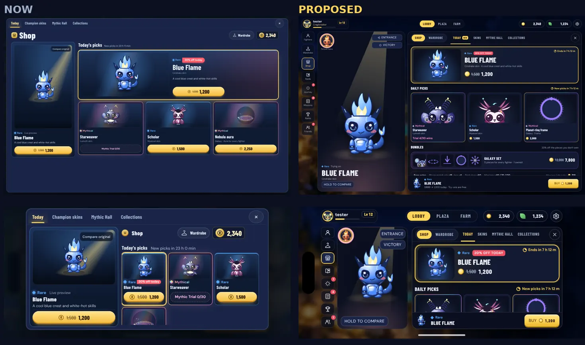              |
| Wardrobe       | 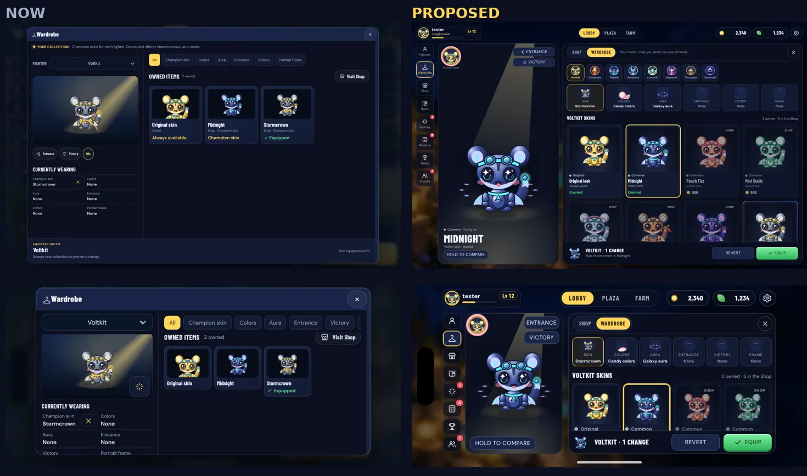      |
| Fighters       | 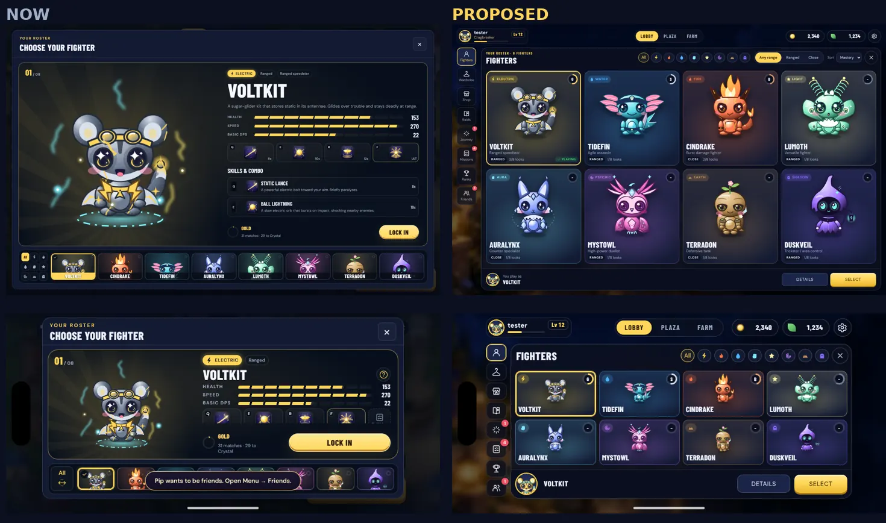          |
| Fighter detail | 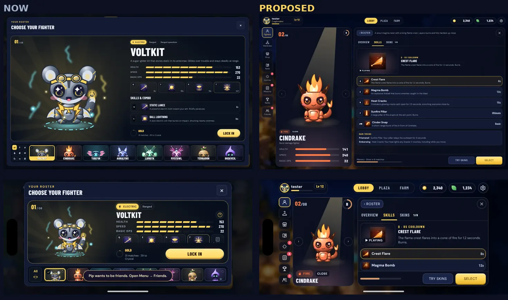 |
| Missions       | 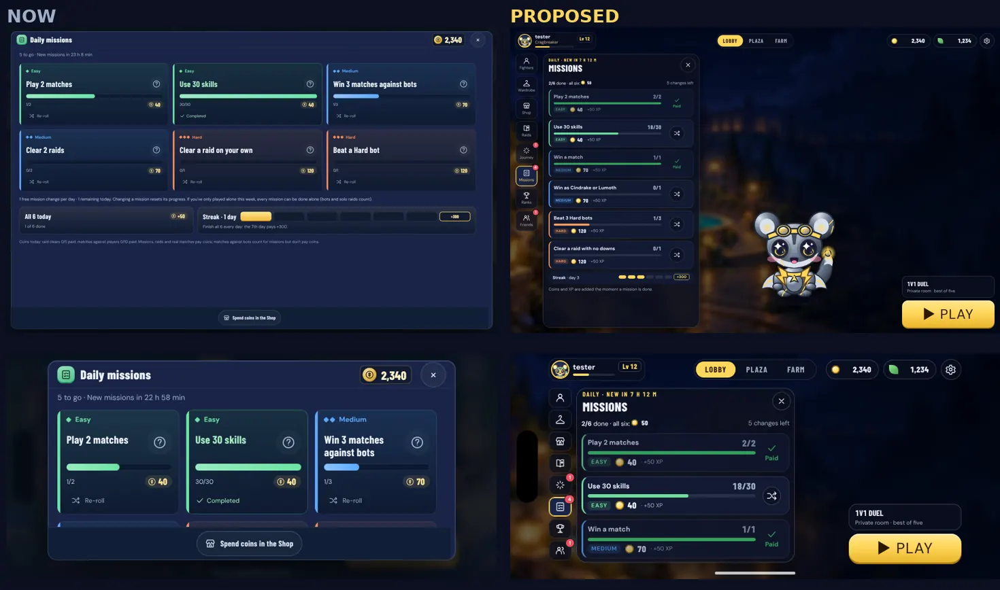      |
| Journey        | 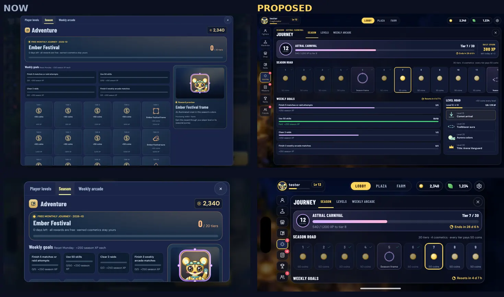        |
| Raid Hall      | 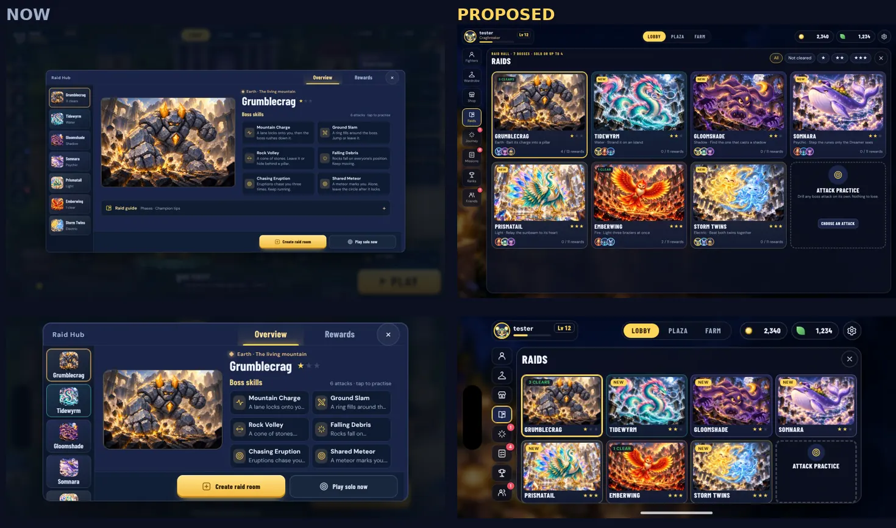        |
| Boss page      | 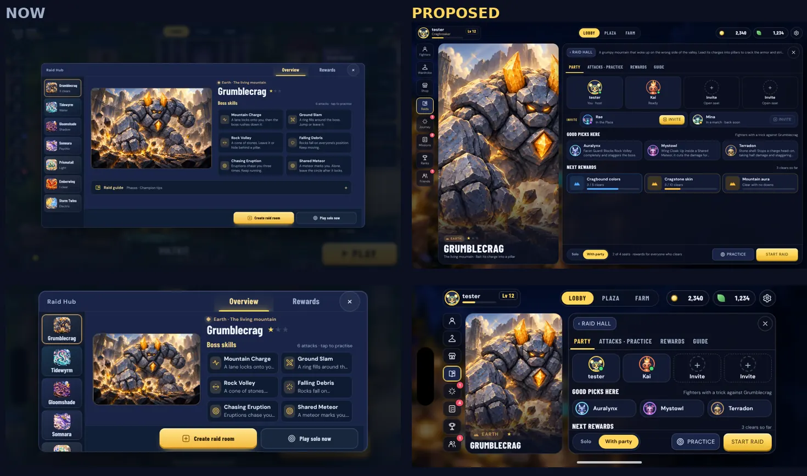         |
| Ranks          | 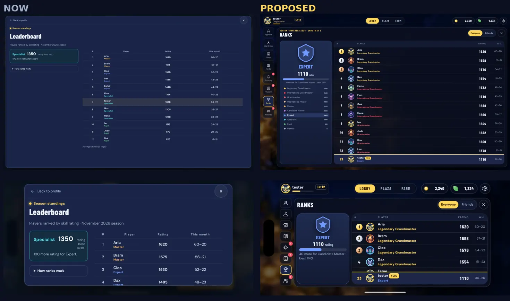            |
| Friends        | 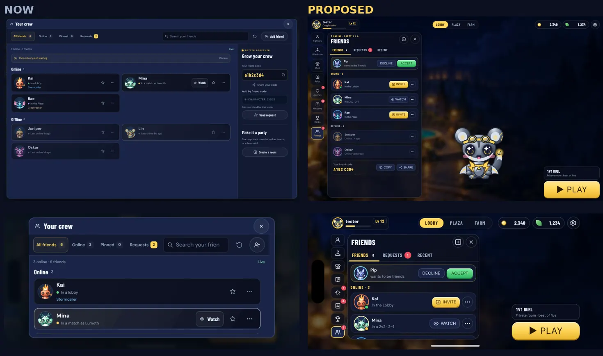        |
| Player card    | 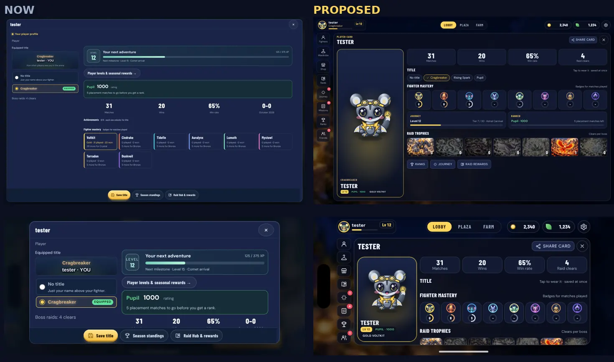    |

The purchase confirmation: [desktop](images/mockups/confirm-desktop.webp),
[phone](images/mockups/confirm-phone.webp).

## The design

### Navigation map

```
Lobby (hub after login: fighter, party slots, PLAY bottom right)
├─ HUD: profile ─────────────► Player card (profile, titles, mastery, trophies, share)
│       coins / leaves ──────► Shop (fitting room)
│       ⚙ ───────────────────► Settings (unchanged in this remodel)
├─ Lobby / Plaza / Farm switch (unchanged)
├─ Rail
│  ├─ Fighters ──► Roster grid ──► Fighter detail (Overview · Skills · Skins) ──► Select
│  ├─ Wardrobe ──┐
│  ├─ Shop ──────┴► Fitting room: one screen, Shop | Wardrobe switch
│  │                 Shop: Today · Skins · Mythic Hall · Collections ──► Buy ──► Confirm
│  │                 Wardrobe: Skin · Colors · Aura · Entrance · Victory · Frame ──► Equip
│  ├─ Raids ─────► Raid Hall (boss cards + Attack practice)
│  │                 └─ Boss page (Party · Attacks/practice · Rewards · Guide)
│  │                      ├─ Start raid ──► Raid room ──► Briefing ──► (match) ──► Results
│  │                      └─ Practice ──► attack drill (existing)
│  ├─ Journey ───► Season road · Levels · Weekly arcade      (sheet or panel)
│  ├─ Missions ──► Daily missions, bonus, streak             (sheet: PLAY stays visible)
│  ├─ Ranks ─────► Your rank + ladder | Leaderboard (Everyone / Friends), your row pinned
│  └─ Friends ───► Friends · Requests · Recent               (sheet: PLAY stays visible)
├─ Party slots ──► Invite (Friends sheet, invite mode)
└─ Mode ▴ / PLAY (unchanged)
```

Rules for every screen:

1. **Screens open inside the Lobby, not over it.** The HUD (profile,
   wallet, settings) and the rail stay visible and usable; the rail shows
   where you are. Switching from Missions to the Shop is one tap.
2. **Two sizes of screen.** A _panel_ fills the space right of the rail
   (Fighters, fitting room, Raids, Journey, Ranks, Player card). A _sheet_ is
   460 px wide (380 on phones) and leaves the Lobby fighter and PLAY visible
   (Missions, Friends, party invite).
3. **Close is always in the panel's top-right corner**, one size (44 px,
   32 px on phones), and Escape or controller Back does the same.
4. **The main action is always bottom right**, where PLAY is. Every screen
   that acts (buy, equip, select, start raid) has an action bar there.
5. **Back goes up one level** (fighter detail → roster, boss → Raid Hall)
   with a small "‹ Roster" button top left; Close leaves to the Lobby.

### Shared design tokens

Defined once in `apps/client/src/ui/tokens.css`. Values come from what the
game already uses (`style.css` `:root`, `cosmetic-tier.ts`), so nothing
changes colour by accident. The mockup's [`ui-kit.css`](mockup/ui-kit.css)
is the draft.

| Group    | Tokens                                                                                                                                                                                                                                                                  |
| -------- | ----------------------------------------------------------------------------------------------------------------------------------------------------------------------------------------------------------------------------------------------------------------------- |
| Surfaces | `--ui-bg-0 #0b1020`, `--ui-bg-1 #121a33`, `--ui-bg-2 #1a2547`, `--ui-bg-3 #243161`, glass `#0b1020e0`, lines `#ffffff1f` / `#ffffff33`                                                                                                                                  |
| Text     | `--ui-text #eef2ff`, `--ui-dim #a0afc8`, `--ui-faint #6f7d99`                                                                                                                                                                                                           |
| Meaning  | gold `--ui-accent #ffd65b` (main action, prices, "you"); green `#43d971` (owned, equipped, online); red `#ef4f61` (alerts and badges only)                                                                                                                              |
| Rarity   | common `#a7b3c6`, rare `#4fa8ff`, epic `#b56bff`, legendary `#ffbf3c`, mythical `#ff8fd8` plus a foil gradient. One set for Shop, Wardrobe, rewards and chips (today the Shop and `cosmetic-fx.css` disagree: Mythical is `#ff9be0` in one and `#ff4f7b` in the other). |
| Elements | the existing `--el-*` colours                                                                                                                                                                                                                                           |
| Presence | online `#43d971`, in a match `#ffbf3c`, in the Plaza `#b56bff`, offline `#6f7d99`                                                                                                                                                                                       |
| Space    | 4 px grid: 4, 8, 12, 16, 24, 32                                                                                                                                                                                                                                         |
| Radii    | 6, 10, 14, 18, 22, pill                                                                                                                                                                                                                                                 |
| Type     | Barlow Condensed (names, numbers, buttons), DM Sans (text), both already bundled. Scale 11 / 12 / 14 / 16 / 18 / 22 / 28 / 36 / 48 px, one step smaller on phones. Numbers always tabular.                                                                              |
| Controls | two heights only: 44 px (32 px small) on desktop, 36 px (28 px) on phones. Action width 152 px (104 px on phones), small width 92 px (76 px).                                                                                                                           |
| Shell    | HUD 52 px (40 on phones), rail 64 px (40), gutter 16 px (8), panel head 64 px (44), Close 44 px (32), safe-area insets on every edge                                                                                                                                    |
| Motion   | 120 / 200 / 320 ms, all 0 under `prefers-reduced-motion`                                                                                                                                                                                                                |

**Buttons (owner's note, 3 Nov):** buttons in a row are always the same
height and the same width, and only colour tells the main one apart (gold,
or green for Equip). Sizes stay moderate so the content keeps the room: no
button is taller than 44 px on desktop or 36 px on phones, and a pair like
Revert / Equip or Details / Select is two 152 px buttons (104 px on phones).
On phones a 36 px button still answers a 44 px finger: its hit area extends
past its edge without changing the layout. The only bigger button is the
Lobby's PLAY, which stays as it is.

### Shared components

All in `apps/client/src/ui/` as small functions returning markup (the
pattern the client already uses), each with its own CSS in
`ui/components.css`:

| Component                                                                 | Used for                                                                                                                                    |
| ------------------------------------------------------------------------- | ------------------------------------------------------------------------------------------------------------------------------------------- |
| `panel()`, `sheet()`                                                      | Every screen's frame: head (kicker, title, tools, Close), body that scrolls, action bar                                                     |
| `tabs()`, `segmented()`, `chips()`                                        | Tabs in the head or under it; two to four equal choices; filter chips                                                                       |
| `button()`, `iconButton()`, `actions()`                                   | The two heights and the equal-width action group                                                                                            |
| `itemTile()`                                                              | One card for every item (Shop, Wardrobe, rewards): fixed rows for art, rarity, name, line, price/state, so a long name never moves anything |
| `price()`, `walletPill()`                                                 | Coin amounts with the coin icon, struck-through old price; the HUD pill reused everywhere                                                   |
| `rarityTag()`, `elementTag()`, `tag()`, `badge()`, `dot()`, `statusDot()` | All the small labels                                                                                                                        |
| `bar()`, `ring()`, `timer()`                                              | Progress bars, mastery rings, countdowns (server time)                                                                                      |
| `row()`, `avatar()`                                                       | List rows (friends, leaderboard, invites) and round fighter avatars with a status dot                                                       |
| `emptyState()`                                                            | "No friends yet", "Nothing owned in this slot", errors with Retry                                                                           |
| `confirm()`                                                               | A modal for anything that spends: item, price, your coins, coins after, Cancel / Buy                                                        |
| `toast()`                                                                 | Above the action bar, never over a button                                                                                                   |

### Screens

Each screen gets its own CSS module (`apps/client/src/screens/<screen>.css`)
that only lays out the shared components. The pull request that adds a module
deletes the old rules it replaces from `style.css` and the old per-screen
files; nothing is stacked on top.

#### Fitting room: Shop + Wardrobe ([compare](images/compare/shop.webp), [wardrobe](images/compare/wardrobe.webp), [confirm](images/mockups/confirm-desktop.webp))

As in the proposal (`docs/hub-redesign/prototype/lobby/template.html`,
"fitting room"): the fighter stands on the left under a spotlight, the
catalogue is on the right, and the action sits bottom right. Shop ⇄
Wardrobe only swaps the catalogue; the stage, try-on and action bar stay.

- **Shop › Today:** the 20%-off pick as a wide featured card with its own
  countdown; the other daily picks; the collection bundles with the full and
  discounted price; an "Earn coins" line (against players: win +15, loss +6;
  raid clear +60; missions +40/70/120; and how many mission coins are left
  today), all from `COINS` in `packages/shared/src/shop.ts`. Then
  **Skins** (avatar row of fighters, owned / not owned / rarity filters),
  **Mythic Hall** (trial progress, with "Play as Lumoth" that sets your
  Lobby fighter), **Collections**.
- **Wardrobe:** a row of fighter avatars instead of the dropdown; six slot
  tabs (skin, colors, aura, entrance, victory, frame) showing what is worn;
  the grid shows the items you own (owner's decision, 3 Nov), with a "More
  in the Shop" tile at the end that switches to the Shop on the same slot.
  Try several things, then Equip once or Revert.
- **Try-on:** tapping any tile puts it on the stage at once; "Hold to
  compare" shows the original; Entrance and Victory replay on the stage.
- **Buy:** the action bar names the item and the price; Buy opens a
  confirmation with the item, price, your coins and coins after, and a
  "Wear it now" box. The server still sets the price and checks the
  balance (`/api/shop/buy` → `arena_buy_item`); what the server answers is
  what the screen shows, and a refusal shows its reason.
- **Mythical:** a foil edge on the tile, and its trial or awakening progress
  instead of a price.
- Inspiration: the featured-plus-daily layout with per-section timers that
  Fortnite and Valorant stores use ([esports.net](https://www.esports.net/news/fortnite/fortnite-item-shop/), [siege.gg](https://siege.gg/news/how-does-valorants-store-work)); a single confirmation that shows the balance after; Brawl Stars moving cosmetics next to each Brawler (the proposal's research). Patterns only.

#### Roster and fighter detail ([compare](images/compare/roster.webp), [detail](images/compare/fighter.webp))

- **Grid:** all eight fighters as cards, coloured by element, with element,
  range, role, mastery ring and "n/8 looks". Filter by element (chips) and
  range; sort by mastery, name or element. Your current fighter is marked
  "Playing". Select (bottom right) sets your Lobby fighter.
- **Detail:** the fighter on the stage with health, speed and basic DPS
  bars; tabs Overview · Skills · Skins. Skills shows every skill as a row
  (key, icon, name, the full description, cooldown) with the selected
  skill's preview playing above; Skins jumps to the fitting room for that
  fighter. ‹ › steps through fighters. Raid tricks for that fighter are
  listed from `RAID_BOSS_PERKS`.
- The raid and PvP room's fighter picker reuses the grid and detail, so
  there is one picker in the game.
- Inspiration: a hero grid coloured by class with filters and a detail page
  of skills and stats (Brawl Stars, Pokémon UNITE). Patterns only.

#### Missions and Journey ([missions](images/compare/missions.webp), [journey](images/compare/journey.webp))

- **Missions** is a sheet: the Lobby fighter and PLAY stay in view. A top
  line with done / six, the all-six bonus and changes left; six rows with a
  difficulty colour, progress, coins and XP, and Paid (✓) or a change button
  (↻); the 7-day streak as dots with the +300 day. Payouts stay automatic
  (decision 11): no Claim buttons, "Paid" is a state, not an action.
- **Journey** is a panel with Season · Levels · Weekly arcade. Season: level
  ring, tier, XP to the next tier, season countdown and Daily Spark in one
  banner; the season road scrolls sideways with cosmetic tiers larger than
  coin tiers and the current tier lit; weekly goals with their reset timer;
  a short level road with the next rewards.
- Every timer (new missions, weekly reset, season end) comes from the
  server's clock.
- Inspiration: battle-pass style season roads with milestone rewards larger
  than filler rewards, daily lists with a reset timer. The prototype's
  `progress.js` layout is followed.

#### Raids ([hall](images/compare/raids.webp), [boss](images/compare/boss.webp))

- **Raid Hall:** seven boss cards (art, name, stars, element, the
  signature mechanic, clears or New, rewards earned, three fighters with a
  trick there) plus an Attack practice card. Locked bosses say why ("Clear
  Grumblecrag first"). Filters: Not cleared, stars.
- **Boss page:** the boss art on the stage; tabs Party · Attacks/practice ·
  Rewards · Guide. Party shows four seats (you, members, open seats to
  invite), online friends with an Invite button, the fighters with a trick
  here, and the next rewards with progress. Bottom right: Solo / With party,
  Practice, Start raid.
- **Raid room:** the same seats and the shared fighter picker, with Ready
  bottom right and no drawer on phones. Drawn in step 5 for the owner's
  review: [raid room](images/mockups/room-desktop.webp)
  ([phone](images/mockups/room-phone.webp)), and the PvP rooms in the same
  frame ([2v2](images/mockups/room-teams-desktop.webp),
  [phone](images/mockups/room-teams-phone.webp)); `?s=room` and
  `?s=room-teams` in the mockup page.
- **Briefing and results:** restyled with the shared panel, tags and
  buttons; their content and timing stay (they are part of the match
  screen's flow, and the match HUD is out of scope).
- Inspiration: raid lobbies with party slots and a ready step (Pokémon GO),
  a quest board of target cards (Monster Hunter). Patterns only.

#### Ranks, Leaderboard and Friends ([ranks](images/compare/ranks.webp), [friends](images/compare/friends.webp))

- **Ranks:** your rank as a tier badge with rating, best rating, progress to
  the next rank and the whole ladder with yours lit; the leaderboard with
  medals for the top three and **your row pinned at the bottom** with your
  rank, whatever your position (the server already sends your rank and
  rating with the top 20). An Everyone / Friends switch needs the server to
  send your friends' rows too (open question 4).
- **Friends** is a sheet: Friends · Requests · Recent tabs; requests on top
  with Decline / Accept; online friends first with a status dot and one
  action (Invite to your party, Join, or Watch); offline with "online 2 h
  ago"; your friend code with Copy and Share. Recent needs a server endpoint
  (open question 4).
- Inspiration: a pinned "you" row on leaderboards
  ([example](https://www.shadcn.io/blocks/radix/web3-leaderboard)); online
  friends with a one-tap invite (Pokémon UNITE, per the proposal's
  research). Patterns only.

#### Player card and profile ([compare](images/compare/profile.webp))

- The card on the left is the same card other players see (fighter in its
  equipped look, title, name, level, rank). "Share card" would save it as a
  picture, drawn on the device the way `share-card.ts` draws match results
  (optional; open question 7).
- Matches, wins, win rate and raid clears as four tiles; titles as chips
  that equip on tap (no Save button); mastery for all eight fighters; Journey
  and Ranked summaries; raid trophies per boss; links to Ranks, Journey and
  raid rewards.

### Phones, notch and performance

- Phones held sideways use the same layouts, one size smaller: the rail
  drops its labels, the stage narrows to 210 px, filter chips scroll
  sideways, the action bar keeps its two buttons.
- Every screen respects `--safe-left/right/bottom` (the Dynamic Island and
  the home indicator) and is checked at 852×393 with 59 / 59 / 21 px insets.
- Only one live fighter renderer runs (the stage), as today. Tiles use
  static pictures (`itemPicture`, already cached).
- **Low graphics** (Settings → Graphics, as the Plaza and Farm): a still
  fighter instead of the animated rig, no spotlight blur or turning aura, no
  backdrop blur. Auto switches to Low when frames are slow, measured the way
  the farm measures it.
- Keyboard and controller: tabs and grids move with arrow keys, Enter
  selects, Escape/Back goes up one level, focus is always visible. Touch:
  tap to try on, hold to compare, swipe the season road.

## Pull requests, in order

Each step is one pull request into `main`, with before-and-after screenshots
in the description. Before every push: `npm run typecheck`, `npm run test`
and `npm run build`. Still run the visual tests for the screens it changes
(Playwright on `/opt/pw-browsers/chromium-1243/chrome-linux64/chrome`), but
don't hold a push for them (owner, 3 Nov): push once the three checks pass,
let the visual tests (local and the `visual` CI job) finish afterwards, and
fix any failure in a follow-up push. Say in the report which visual tests
had passed at push time.

| #   | Pull request                   | Ships                                                                                                                                                                                                                                                                                                                                                                                   | Deletes                                                                                                                                                 |
| --- | ------------------------------ | --------------------------------------------------------------------------------------------------------------------------------------------------------------------------------------------------------------------------------------------------------------------------------------------------------------------------------------------------------------------------------------- | ------------------------------------------------------------------------------------------------------------------------------------------------------- |
| 1   | Design foundation              | `ui/tokens.css`, `ui/components.css`, the component functions, the panel/sheet shell that keeps the HUD and rail visible, and the server's clock: every `/api` answer carries `X-Server-Time`, and one `serverNow()` feeds every hub timer. The measuring helper for the visual tests (below). Fixes the "Open Menu → Friends" toast. No screen changes look yet, apart from the shell. | The old dialog sizing and Close rules once every screen uses the shell (the rest go with their screens).                                                |
| 2   | Fitting room (Shop + Wardrobe) | `screens/fitting-room.ts` + `.css`: stage, Shop                                                                                                                                                                                                                                                                                                                                         | Wardrobe, all four Shop tabs, six Wardrobe slots, unowned items in the Wardrobe, the purchase confirmation, Low graphics path. Existing endpoints only. | Shop, Shop preview, rarity and Missions-card rules in `style.css`; `mobile-store.css`; `wardrobe.css`; `shop-preview-layout.ts` if unused. |
| 3   | Roster                         | `screens/roster.ts` + `.css`: grid, filters, sort, fighter detail, shared with the room's fighter picker.                                                                                                                                                                                                                                                                               | Roster and champion-selection rules in `style.css`; `champion-selection.css`; `mobile-panels.css` parts for the picker.                                 |
| 4   | Missions and Journey           | `screens/missions.ts`, `screens/journey.ts` (+ `.css`): the sheet, the season road, weekly goals, levels; server-time timers.                                                                                                                                                                                                                                                           | Mission, streak and Adventure rules in `style.css`.                                                                                                     |
| 5   | Raids                          | `screens/raid-hall.ts`, boss page, room, briefing and results styles.                                                                                                                                                                                                                                                                                                                   | Raid Hub, raid lobby, briefing and result rules in `style.css` (match HUD rules stay).                                                                  |
| 6   | Ranks, Leaderboard and Friends | `screens/ranks.ts`, `screens/friends.ts` (+ `.css`); the pinned row; Friends as a sheet; Recent if approved.                                                                                                                                                                                                                                                                            | Ratings, leaderboard and friends rules in `style.css`; `friends.css`.                                                                                   |
| 7   | Player card and profile        | `screens/profile.ts` + `.css`; titles equip on tap (the existing equip call).                                                                                                                                                                                                                                                                                                           | Profile, title picker and progress rules in `style.css`; `player-card.css` if unused.                                                                   |

Matches are untouched in every step. Where a selector is shared with the
match screens (buttons, rarity badges in results), the match keeps its rule
until a later pass.

### Tests

- A helper next to `tests/visual/helpers.ts` (`ui-measure.ts`) with the
  checks the mockups already pass (see "Checked in the mockups"):
  - buttons in an `actions()` group: equal width and height, same top edge;
  - small buttons in a row: equal height;
  - Close at the same offset from its panel's corner on every screen;
  - HUD, rail, stage, panel and PLAY never overlap, and stay inside the
    safe-area insets at 852×393;
  - no button label cut off; tiles keep the same size whatever the name;
  - touch: on phones every control's hit area is at least 44 px;
  - text centring checked by pixels for buttons and pills (the way
    `tests/visual/farm.spec.ts` does).
- Each screen's spec opens it at the four sizes, runs the helper, and
  attaches screenshots. Visual specs that point at the old screens
  (`shop-*.spec.ts`, `fighter-select.spec.ts`, `roster-*.spec.ts`,
  `regular-raids.spec.ts`, `raid-practice-hub.spec.ts`, `journey-levels.spec.ts`,
  `cosmetic-displays.spec.ts`, `dialogs.spec.ts`, …) move to the new
  selectors in the same pull request; what they check stays.
- Unit tests for the parts that are logic: filters and sort, server-time
  countdowns, which slots an item covers, the confirmation's numbers.
- Phone smoothness: frame times on the fitting room and roster with the CPU
  throttled 4×, High and Low, recorded in each pull request.

### Checked in the mockups

A script (`mockcheck`, to become `ui-measure.ts`) opened all 12 mockup
screens at 1440×900, 1280×720, 844×390 and 852×393 with the insets: 0
unequal button groups, 0 overlaps between HUD, rail, stage, panel and PLAY,
0 boxes in the safe-area insets, 0 cut-off button labels; Close at 11 px
from the corner and 44 px on every desktop panel, 7 px and 32 px on every
phone panel.

## Progress

### Step 1: design foundation (built 3 Nov 2026)

- `apps/client/src/ui/tokens.css`: every token. The three `:root` blocks in
  `style.css` moved here unchanged (the old names now point at the new
  `--ui-*` ones), so nothing changed colour.
- `apps/client/src/ui/components.ts` + `components.css`: buttons (two
  heights; `actions()` makes equal groups), panel and sheet, tabs, segmented,
  chips, item tile, price, tags, rarity and element tags, bars, rings,
  timers, avatars, rows, empty state, confirmation. Base rules have zero
  specificity, so a component class always wins over them.
- `apps/client/src/ui/hub-panel.ts`: `openHubPanel()` mounts a screen inside
  the Lobby (HUD and rail stay usable, the rail marks it, Escape and Close
  leave, Lobby parts under a full panel stop drawing and leave the tab
  order); `askConfirm()` asks before spending.
- **Server time:** every `/api` answer carries `X-Server-Time` (exposed to
  the static site through CORS). The client keeps the offset
  (`server-clock.ts`) and the daily countdown (Shop, Missions, Lobby,
  Daily Spark) and friends' "online 2 h ago" use it.
- **Toast:** one definition (five stacked rules left `style.css`); in the
  Lobby it sits under the HUD, and above the action bar when a screen is
  open. The friend-request toast says "Open Friends to answer." instead of
  pointing at a Menu the Lobby doesn't have.
- **Found while measuring:** the Lobby's `.lobby-layer button` rule out-ranked
  component buttons (now zero specificity); the Lobby's "pause animations
  when covered" rule froze anything inside it (now skips the screen layer);
  a 1 px border shrank 36 px buttons' hit area to 42 px (now a centred 44 px
  box); icon + label buttons were 1.5 px right of centre (icon side bearing
  and trailing letter-spacing, now cancelled).
- **Not yet:** no real screen uses the shell; each moves in its own step. A
  sheet keeps PLAY and the mode usable, but on desktop the Lobby's party row
  (about 800 px) is half under a 460 px sheet; the stage is re-centred beside
  a sheet in step 4, with the first real sheet (Missions).
- Tests: `tests/visual/ui-foundation.spec.ts` (all four sizes, using
  `tests/visual/ui-measure.ts`), `tests/unit/ui-components.test.ts`,
  `tests/unit/server-clock.test.ts`, and a CORS integration test for the
  clock header.

### Step 2: the fitting room (built 3 Nov 2026)

Before and after: [Shop](images/step2/shop.webp),
[Wardrobe](images/step2/wardrobe.webp); every size in
[`images/step2/`](images/step2/).

- `apps/client/src/screens/fitting-room-view.ts` (markup and rules, no DOM)
  and `screens/fitting-room.ts` (behaviour) + `fitting-room.css` (layout
  only). The Shop and the Wardrobe are one screen opened inside the Lobby
  with `openHubPanel` (rail, HUD coin pill and Missions → Shop all lead
  there). Shop | Wardrobe only swaps the catalogue; the stage, what you
  are trying on and the action bar stay.
- **Stage:** the live rig (`mountShopPreview`) on the left, the portrait
  frame you'd wear top left (it opens the Frame slot), Entrance and
  Victory top right, Hold to compare (pointer, Space or Enter held down)
  and a Mythical's I / II / III at the bottom. A frame is shown large on
  its portrait, with the boss frame's 0–5★ preview. **Low graphics:** a
  still fighter, no rig, no blur; Hold to compare swaps two stills.
- **Shop:** Today (the 20%-off pick as a wide card with its own countdown,
  the other picks, the three sets nearest to complete, the Earn coins
  line from `COINS`/`MISSION_COINS` with the mission coins left today),
  Skins (fighter avatars, All / Owned / Not owned, rarity chips), Mythic
  Hall (trial or awakening progress; a locked Mythical offers "Play as
  …", which sets your Lobby fighter), Collections. It opens on today's
  deal, already on the stage.
- **Buying:** Buy opens `askConfirm()` (item, price and full price, your
  coins, coins after, "Wear it now"); then `/api/shop/buy`, and the
  screen shows the server's answer, or its reason when it refuses. Short
  of coins, "Earn coins" (Missions) sits beside a disabled Buy, the same
  size. Testers with unlimited coins see "Unlimited" and never "short";
  testers with Mythic access skip trials and see every stage.
- **Wardrobe:** the fighter row, six slot tabs showing what each slot
  holds (a dot marks an unsaved change), owned items only plus "Original
  look" / "No aura"… first and **More in the Shop** last (it opens the
  Shop on that slot: Skins, Not owned; or Collections). Try several
  things, then **Equip** once (one `/api/shop/equip` or `/api/raids/equip`
  per changed slot; a Mythical saves the highest stage reached) or
  **Revert**. Try-ons of things you don't own are never saved.
- **Refreshes keep what the browser built:** `ui/patch.ts` (from the old
  `shop-content.ts`) patches the screen from new markup, so a fresh copy
  of your coins keeps the canvas, pictures, focus and scroll; a new star
  level updates the frame in place (no flicker).
- **Foundation additions:** a split panel (`.ui-panel.is-split`, stage +
  catalogue, Close still in the corner) and `--stage-w` (440 / 390 /
  210 px); a `sub` line in `confirmModal`; `hub-panel.ts` closes a screen
  whose Lobby leaves the page (Plaza, Farm, a match) and fires
  `ui-panel-change`, so a downloaded update waits until the screen
  closes (`pwa.ts`); another rail item closes the open screen
  (`main.ts`); `ui-measure.ts` checks only the confirmation's buttons
  for finger size while it covers the screen; the gamepad's right stick
  scrolls `.ui-panel-body`.
- **Deleted:** `wardrobe-ui.ts`, `wardrobe.ts`, `shop-content.ts`, the
  Shop markup in `shop-ui.ts` (475 → 74 lines: coin pills, countdown and
  item pictures stay, Missions and Journey use them), `mobile-store.css`
  (687 lines), `wardrobe.css` (836), the Shop/Wardrobe rules of
  `cosmetic-review.css` (268 → 27) and 1,483 lines of Shop, Wardrobe and
  rarity rules in `style.css`. A script removed only selectors built on
  classes no source produces any more (keeping live alternatives inside
  `:is()`), and Journey, Missions and Raids were compared pixel by pixel
  before and after (identical apart from the moving countdown).
- **Kept for later steps:** `.shop-preview`, `.shop-live-stage` and
  `.shop-preview-fallback` rules (Journey's reward preview uses them, and
  the live rig needs the last two; step 4) and `.shop-intro`,
  `.shop-note`, `.shop-status` (Missions, step 4). `shop-preview-layout.ts`
  is still used by the rig.
- **Choices made while building:** on phones the stage shows only the
  fighter and its tools (the name is in the action bar), and a
  Mythical's I / II / III stand in a column at the stage's right edge, so
  the stage never changes size. The rig's canvas is 400 px wide and not
  pixel-ratio aware (as before), so the stage host is capped at 500 px:
  the fighter is a little smaller than in the mockup on desktop but
  stays sharp. Opening the Wardrobe from the Shop keeps the fighter on
  the stage.
- **Tests:** `tests/unit/fitting-room.test.ts` (prices and the
  confirmation's numbers, trials, testers, filters, owned-only Wardrobe,
  pending changes, try-on outfit, Low graphics), the frame-level and
  hold-to-compare unit tests, and `tests/visual/fitting-room.spec.ts` at
  the four sizes with `ui-measure.ts` (plus buying and a refusal,
  Equip/Revert, keyboard, Low graphics, reduced motion, rail switching,
  a late answer). `shop-stability`, `shop-preview-switching`,
  `shop-spotlight`, `cosmetic-displays`, `cosmetic-review`,
  `portrait-frames`, `frame-level-preview` and the soak test in
  `battle-performance` moved to the new screen; what they check stays.
  `tests/visual/shop-server.ts` stands in for the Shop's server calls.
- **Frame times** (852×393, CPU throttled 4×, idle on the Shop; this
  machine renders on the CPU, so only the comparison means anything):
  before High 333 ms / Low 317 ms (the old Shop ran the rig on Low too);
  after High 250 ms / Low 83 ms.

### Step 3: the roster (built 3 Nov 2026)

Before and after: [roster](images/step3/roster.webp),
[fighter detail](images/step3/fighter.webp); every size in
[`images/step3/`](images/step3/).

- `apps/client/src/screens/roster-view.ts` (markup and rules) and
  `screens/roster.ts` (behaviour) + `roster.css`. The rail's Fighters
  opens it inside the Lobby (`openHubPanel`); the old Fighters drawer is
  gone from the hub.
- **Grid:** every fighter (sixteen since the new champions landed on 3
  Nov) as cards of one size coloured by element, as many to a row as fit,
  scrolling: element, mastery ring, role, range, owned looks ("1/1" for a
  champion without skins yet) and "Playing" on yours.
  Element chips, Any range / Ranged / Close and Sort (Mastery, Name,
  Element). Bottom right: Details and Select (Select says "Playing" on
  your fighter). Select makes the fighter your Lobby fighter and returns
  to the Lobby.
- **Fighter detail:** the split panel from step 2. The fighter on the
  stage (the live rig in the "selection" framing; a still fighter on Low
  graphics), its number, mastery ring, ‹ › and health / speed / basic DPS
  bars; tabs Overview (description, combo, mastery, basic attack, dash and
  jump), Skills (the chosen skill large, every skill and the basic attack
  as rows with key and cooldown, raid tricks from `RAID_BOSS_PERKS`) and
  Skins (the looks you own and the rest). "‹ Roster" goes back up; Try
  skins opens the Shop on that fighter's skins.
- **Keyboard and touch:** arrows move through the cards (focus picks); a
  second click, tap or Enter on the picked card opens its detail; `[` and `]` step fighters, arrows move
  through the skills and tabs; Escape leaves.
- **The rooms keep their picker until step 5** (owner, 3 Nov): the roster
  is built to be the one picker (`action: "lock"` turns Select into Lock
  in), and step 5 puts it in the PvP and raid rooms while redrawing them.
  So `fighter-selection.ts`, `champion-selection.css` and the picker parts
  of `mobile-panels.css` stay until then; this step deletes only the hub
  drawer's rules (`.home-roster-drawer`, `#home-fighter-panel`: 13 rules
  in `champion-selection.css`, 10 in `style.css`).
- **Found in review and fixed:** stepping fighters on the stage dropped
  the live rig's canvas (the stage is now swapped whole and the preview
  re-attached); a second click only opened the detail as a fast
  double-click; a filter could hide the picked fighter while Details and
  Select still acted on it (the first fighter shown is picked, and with
  none shown both are disabled); focus could fall to the page after "Show
  all" or move with a reordered card.
- **Tests:** `tests/unit/roster.test.ts` (filters, sort, mastery, looks,
  stats, raid tricks, tabs, the room's Lock in), `tests/visual/roster.spec.ts`
  at the four sizes with `ui-measure.ts` (plus Select, Try skins,
  keyboard, Low graphics, reduced motion). `fighter-select`,
  `roster-skill-icons`, `roster-smooth` and the Lobby spec's Fighters check
  moved to the new screen; what they check stays.

### Step 4: Missions and Journey (built 4 Nov 2026)

Before and after: [Missions](images/step4/missions.webp),
[Journey](images/step4/journey.webp); every size in
[`images/step4/`](images/step4/).

- `apps/client/src/screens/missions-view.ts` and `journey-view.ts` (markup
  and rules, no DOM), `missions.ts` and `journey.ts` (behaviour), and
  `missions.css` / `journey.css` (layout only). The rail, the Lobby's
  cards and the fitting room's "Earn coins" open them inside the Lobby
  (`openHubPanel`).
- **Missions is the first sheet.** A top line with done / six, the all-six
  bonus and the changes left; six rows with the difficulty colour,
  progress, coins and XP, and Paid (✓) or a change button (↻, "Swap for a
  solo mission" on a mission that needs others). Payouts stay automatic:
  Paid is a state. The 7-day streak as dots with the +300 day. A row's
  text is one button that opens how to complete the mission under it (the
  old per-mission "?" popups, same text). A change asks the server
  (`/api/missions/reroll`) and shows its answer or its reason; every
  change button waits while one is on its way.
- **The Lobby beside a sheet** (step 1's note): `hub-panel.ts` marks the
  Lobby (`data-ui-sheet`) while a sheet is open, and one block in
  `ui/components.css` moves the stage and the emotes into the room right
  of the sheet. On phones the side cards make way (the sheet says what
  they say) and the stage takes the room above PLAY, so the fighter stays
  whole, if smaller: measured 310 px wide at 1440×900 (560 without the
  sheet), 220 px at 1280×720 (494), 134 px at 844×390 (234) and 120 px
  on the island phone (220), its smallest size. The live rig keeps running behind a sheet (the spec compares
  two pictures of it a few seconds apart) and PLAY stays usable. This
  keeps `lobby.css` untouched for the Lobby work going on in parallel.
- **Journey is a panel** with Season · Levels · Weekly arcade as tabs in
  its head. Season: one banner (level ring, the season and its tier, XP to
  the next tier, "Ends in …", the Daily Spark), the season road scrolling
  sideways (wheel, swipe, or arrows once focused) with the four cosmetic
  tiers larger than the coin tiers, earned tiers ticked and the next tier
  lit and scrolled into view; the weekly goals with "Resets in …"; a short
  level road with the next four milestones. Levels: every milestone to
  level 100 (titles and cosmetics, earned or not) and how XP is earned.
  Weekly arcade: this week's event, its countdown, and Private 1v1 /
  Private 2v2 / Play vs AI as three equal buttons in the action bar.
- **Equip:** picking a reward shows it in the action bar (picture, where it
  comes from, whether you own or wear it) with Wardrobe and Equip (Locked
  until it is yours). Equip goes through `/api/raids/equip`, as the
  Wardrobe does. The old reward preview with its own live rig is gone; the
  fitting room is where things are tried on.
- **Server time:** the daily countdown (`picksCountdown`), and the new
  `ui/countdown.ts` for the weekly reset (next Monday, Pacific) and the
  season's end (the first Pacific day of the next month), all on
  `serverNow()`. The arcade week and a missing season id use the server's
  Pacific date too. The sheet and the panel redraw their countdowns every
  30 s while open (patched in place). The old screen said "0 days left"
  when the device's month and the season disagreed.
- **Deleted:** `missions-ui.ts`, the Adventure markup in `adventure-ui.ts`
  (210 → 67 lines: the level bar and result-card XP stay for the results
  and the profile), the Missions and Adventure hooks in `dialog.ts`, and
  1,600 lines of `style.css`: the Mission, streak, Adventure, season,
  Journey reward-preview and old home-mission rules, `.shop-intro`,
  `.shop-note`, `.shop-status`, `.shop-preview`, `.shop-preview-visual` and
  `.shop-preview-text` (`.shop-live-stage` and `.shop-preview-fallback`
  stay for the live rig), and the Journey preview's frame sizing in
  `journey-frames.css`. As in step 2 a script removed only selectors built
  on classes no source emits (keeping live alternatives inside `:is()`),
  and the Lobby, Shop, Wardrobe, roster, fighter detail, Raids, Ranks,
  Friends and profile were compared pixel by pixel before and after at
  1440×900 and 844×390: identical apart from the Lobby's random sparkles
  and the Shop's moving countdown.
- **Choices made while building:** the new classes avoid every old name so
  the prune could tell them apart. On phones the season road's tiers are
  64 / 84 px wide and the Daily Spark stays in the banner (the mockup hid
  it; the old spec required it on phones). `ui-measure.ts` now checks a
  phone control's 44 px reach only while the control is wholly in sight
  (a row scrolled out of its list is checked once scrolled to; the specs
  do that).
- **Tests:** `tests/unit/missions.test.ts`, `countdown.test.ts` (weekly
  reset, season end, daylight saving) and the Journey checks in
  `journey.test.ts` / `journey-cosmetics.test.ts`;
  `tests/visual/missions.spec.ts` and `journey.spec.ts` at the four sizes
  with `ui-measure.ts` (plus changing a mission and a refusal, equipping,
  keyboard, reduced motion, Low graphics). `journey-levels.spec.ts` became
  `journey.spec.ts` (its 700×390 size too); `mission-changes-ui.test.ts`
  and the Missions parts of `shop-ui.test.ts` became `missions.test.ts`;
  `level-cosmetics`, `regular-raids`, `fitting-room` and `landscape-only`
  moved to the new screens. What they check stays.
- **Verified:** typecheck, the unit tests and the build on the merged
  commit; locally the visual specs of every screen this step touches
  (missions, journey, lobby, lobby-fighter-rig, ui-foundation,
  lobby-safe-area, fitting-room, level-cosmetics, regular-raids, roster,
  dialogs: 68 tests) passed. Not verified: real phones, the live server.
- **Process (owner, 4 Nov):** from step 4 on, work goes straight to `main`
  once typecheck, tests and build pass; no pull request.

### Step 5: Raids, part 1 (built 4 Nov 2026)

Before and after: [Raid Hall](images/step5/raids.webp),
[boss page](images/step5/boss.webp), [briefing](images/step5/briefing.webp),
[results](images/step5/results.webp); every size in
[`images/step5/`](images/step5/). Part 1 is everything but the raid room,
which waits for the owner's look at its mockup (above).

- `apps/client/src/screens/raid-hall-view.ts` (markup and rules, no DOM),
  `raid-hall.ts` (behaviour) and `raid-hall.css` (layout only). The rail's
  Raids, PLAY on Boss Raid, the Play panel and the profile's Raids link
  open it inside the Lobby (`openHubPanel`), and leaving a raid room comes
  back to the boss page on the tab you left from.
- **Raid Hall:** the seven bosses as cards of one size (splash art, name,
  stars, element, the signature mechanic, clears or New, rewards earned,
  three fighters with a trick there) and an Attack practice card. Locked
  bosses say "Clear Grumblecrag first". Filters All · Not cleared · ★ ·
  ★★ · ★★★, with an empty state and "Show all" when nothing is left.
- **Boss page:** the split panel from steps 2 and 3, with the boss's art
  on the stage; "‹ Raid Hall" goes back to the card you came from. Tabs:
  **Party** (four seats: you, your Lobby party, open seats; your online
  friends with Invite, which is the Lobby's party invite and shows the
  server's answer; the three good picks; the next three rewards with their
  progress), **Attacks · practice** (every attack; the one picked is what
  Practice drills), **Rewards** (every reward with its picture, rarity and
  progress; Wardrobe to wear them) and **Guide** (the blurb, the three
  chapters, every fighter trick, the solo and team rules). Bottom right:
  Practice and Start raid; bottom left Solo / With party and what it
  means. A leader with a party raids with it (Solo is off); a member sees
  "Your party leader starts the raid."; a locked boss says why.
- **Briefing and results** use the shared panel, kicker, title, tags and
  equal buttons (`screens/raid-cards.css`). Their content and timing are
  the match's own: the three steps with their diagrams, the details, the
  stats, the scoreboard, the save state, the retry count, the XP. The
  rites, countdown and pause keep the match card (match HUD: out of
  scope). Every timer in these cards already comes from the server's
  snapshot (`remaining`, `elapsed`); the hall and boss page have none.
- **Deleted:** `raid-hub.ts`, the Raid Hub's appearance picker
  (`raidAppearance`, `raidCosmeticOptions`: the Wardrobe equips the same
  slots since step 2), the Raid Hub branch of `dialog.ts`, the broken
  `raid-lobby-preview.html` (it imported two modules that no longer
  exist), and 2,045 lines of `style.css` (434 rules, 13 selectors trimmed):
  the Raid Hub, its boss rail and showcase, the old rewards tab, and the
  briefing and result rules. As in steps 2 and 4 a script removed only
  selectors built on classes the sources emitted before this step and no
  longer emit (kept live alternatives inside `:is()`; classes built at
  run time were never touched), and the Lobby, mode menu, Play panel,
  roster, Shop, Wardrobe, Journey, Missions, Ranks, Friends, party invite,
  profile, Settings and the raid room were compared pixel by pixel before
  and after at 1440×900 and 844×390: the only differences were the live
  rigs, the Lobby's sparkles, the toast's timing and the countdown.
- **Choices made while building:** the results' "Raid Hub & rewards"
  button and the room's "Raid Hub & rewards" button are gone: Raids is a
  Lobby screen now, and "Return to menu" lands on the boss page (one tap
  from Rewards). The boss art fills the stage (cover, as in the mockup),
  so a tall stage shows part of the wide picture. On narrow phones (an
  iPhone SE sideways, 568 px) the boss page drops the stage so its
  actions fit. The scoreboard keeps the `.raid-score-avatar` portrait so
  frames and colours still show on it.
- **`ui-measure.ts`:** a phone control's 44 px reach is checked only while
  that reach is in sight inside a scrolling list (a button resting on the
  list's edge is checked once scrolled, which the specs do).
- **Tests:** `tests/unit/raid-hall.test.ts` (unlocks, filters, tricks,
  next rewards, seats, invites, what Start raid can do, the reward checks
  from the old Raid Hub tests), `tests/visual/raids.spec.ts` at the four
  sizes with `ui-measure.ts` and label centring measured on the pixels
  (plus Invite and a refusal, Practice, a party leader and member,
  keyboard, reduced motion, Low graphics, an iPhone SE).
  `regular-raids`, `raid-practice-hub`, `raid-room-return`,
  `raid-roster-scroll` (now the hall's cards), `raid-splash`,
  `raid-briefing`, `hub-after-raid`, `cosmetic-displays`,
  `frame-level-preview`, `raid-overlay`, `raid-presentation`,
  `raid-lobby` and `landscape-only` moved to the new screens; what they
  check stays. `raid-splash` no longer runs at 414×896 (a portrait
  desktop window; phones are landscape only) and accepts the stage's
  cover crop.

### Split-panel balance (4 Nov 2026)

Owner's note: on a big window the fighter detail had a narrow 440 px stage
with the fighter hanging under its top edge, beside a text column more than
1,100 px wide. The same split (fixed stage, main column takes the rest) was
in the fitting room and the raid boss page; Journey's weekly goals had the
same problem as a list (bars 1,250 px long beside a 320 px level road).

- **Split panel** (`ui/components.css`, `ui/tokens.css`): on desktop the
  main column stops at `--split-main` (`clamp(720px, 48vw, 920px)`;
  `clamp(760px, 58vw, 920px)` under 821 px of height, where the fighter is
  height-bound and extra stage width would be empty) and the stage takes
  the rest, never below `--stage-w`. Hero-left, details-right, as current
  hero pages do (Valorant, Marvel Rivals, Overwatch 2, LoL). Phones keep the
  fixed narrow stage. 1720×1360: stage 782 / main 826 (was 440 / about 1,165);
  1440×900: 608 / 720 (was 440 / about 885).
- **Roster stage** (`roster.css`): three grid rows (number and mastery, the
  fighter, the nameplate), so the fighter is centred in the room it has at
  any height; ‹ › sit level with it. The rig box grows to 760 px wide
  (sharp: see "Sharp preview rigs" below). A
  wide stage (container query, 640 px) puts the stats beside the name; a
  coloured pool sits at the fighter's feet. The spotlight comes from the
  top-right corner (owner's note) and hangs from the fighter's feet, leaning
  up to the right (`.roster-rig::after`, a soft-edged conic cone), so it
  lands on the fighter at any stage size; pinned to the corner at a fixed
  angle it missed the fighter on a tall stage. The huge outlined name behind
  the fighter was dropped (owner: redundant with the nameplate).
- **Fitting room**: the live host is up to 500 px on a narrow stage (as
  before) and as wide as the stage on a wider one, so a big stage shows a
  big fighter (sharp: see "Sharp preview rigs" below). On phones the
  fighter is drawn 34 px lower (the host moves down whole, so it keeps its
  size): Entrance and Victory no longer cover its ears and crest (owner's
  note).
- **Journey**: weekly goals are cards two to a row when the column has
  800 px; the level road is `clamp(320px, 30%, 420px)`.

### Sharp preview rigs (4 Nov 2026)

The fitting room, roster and Lobby draw their fighter with the live rig on
a Phaser canvas. The canvas already drew at the screen's density, but only
within about a million pixels, and the fighter's parts were bitmaps
rasterized from their SVG at one pixel per art unit, then drawn at 2 canvas
pixels per unit in the 480 px framing, times the canvas resolution: on a 2×
screen every texture pixel covered about 4 screen pixels, however big the
canvas. Measured on the roster stage: a 156 × 148 head texture drawn about
620 px tall.

- **Textures to match the canvas** (`animation/rig-textures.ts`): a preview
  rasterizes its rig's parts `k` times bigger (`setRigTextureScale`,
  `loadRigTextures`), with k = half the framing's scale × the canvas
  resolution, rounded up to a half, at most 4; 1 on Low graphics and when
  the stretch is 1.25 or less. The texture's `resolution` says so, which
  Phaser's canvas renderer divides a frame by when it draws, and rig images
  size themselves (and so their origins) by it (`sizeByResolution` in
  `rig.ts`, from each part's art width in `artWidths`), so the fighter keeps
  its size and position and gains detail. Battles keep 1 and draw exactly
  as before (the WebGL renderer ignores `resolution`).
- **Colors** (`cosmeticLayer`): a recoloured part copies its source raster;
  its stars, sparks, cracks and glow are drawn in art units (a canvas
  transform), so they look the same at any k.
- **Canvas**: up to 3× density and 4 million pixels, rounded up to a
  quarter so it never has fewer pixels than it is shown at.
- **Memory**: a look at k = 3.5 is about 11 MB of textures (was about 1 MB);
  the preview keeps three looks instead of eight once k ≥ 3.
- **Stages**: the fitting room's host is as wide as its stage again and the
  roster's rig grows to 760 px, both sharp.
- **Not handled:** a window made bigger after a fighter has loaded keeps
  that look's textures until the next fighter or look (the canvas itself
  follows at once).
- Tests: `tests/unit/rig-textures.test.ts`; on the roster at 1720×1360 the
  head is a 546 × 518 texture at resolution 3.5 for an 840 px canvas, and
  matches the still SVG fighter at the same size.

### Display fixes from the owner's phone (4 Nov 2026)

- **Shop → Wardrobe kept a Shop try-on:** the Wardrobe shows only what you
  own, so a skin tried on in the Shop stayed on the stage while the Skin
  slot read "Original". Going to the Wardrobe now drops try-ons of things
  you don't own (`dropUnownedTryOns`); owned try-ons stay as changes to
  Equip.
- **A stray line across the phone stage:** the old Shop preview's inset
  1 px outline (`.shop-live-stage` box-shadow) showed once the host moved
  down 34 px; the fitting room's host has no outline now. On phones
  Entrance and Victory are round 40 px icon buttons in a column at the
  stage's right edge (labels kept for screen readers): as 76 px text
  buttons they covered a tall fighter's crest even with the fighter drawn
  lower (owner's note, Blue Flame).
- **The Farm lifted off the bottom when the Menu opened (iOS):** the scroll
  lock pinned the body because iOS measured the page taller than the screen
  (`body { min-height: 100vh }` is the toolbar-less height). Hub scenes and
  battles are never pinned now, and the body uses `100dvh`. Not reproducible
  in desktop Chromium; covered by `tests/unit/scroll-lock.test.ts`.
- **Farm Shop buy buttons:** fixed widths in em (3.3em for "5 · 25") and an
  `inline-block` that undid the button's flex row let the price and leaf
  spill out; the action buttons have minimum widths now and grow with
  their price.
- **Audit:** every hub screen (each tab), every Farm sheet and tab, the
  Plaza's panels, the raid lobby, briefing and results, profile, settings
  and invite, at 932×430 (island), 844×390 and 1440×900, checked for text
  or icons spilling out of buttons, pills and chips (a DOM check that found
  the Farm button on the old CSS), and every rail screen, dialog, menu and
  scene switch opened and closed, comparing the Lobby before and after.
  Nothing else spilled or was left behind. In this CPU-rendered harness
  the Lobby's return animation waits on a 0.8 s frame after a full screen
  closes; it lands in the right place.

### Step 5: the boss page on a big window (4 Nov 2026)

Owner's note (a 1720×1392 window): the boss art was cropped and the right
side had too much empty space; then, the blurred fill didn't look right and
the gold Invite button's label sat off-centre; then, a vertical design for
the boss pictures, with the face on phones. Before and after:
[boss page, tall window](images/step5/boss-tall.webp); every boss, tall
stage and phone: [posters](images/step5/boss-posters.webp).

- **Vertical boss pictures** (owner's third note: showing the whole wide
  picture wasn't to his liking; redesign the boss pictures vertically, and
  show the boss's face on a phone's small stage). No new painting could be
  made in this session, so each boss's painting is framed vertically by
  hand: `BOSS_FRAMES` in `raid-hall-view.ts` gives, per boss, the point
  kept in the middle of a tall stage (head and body together, like a
  poster) and the face a phone zooms in on (1.2× to 2×). The painting
  always fills the stage at its own shape, moved so that point sits in the
  middle without leaving a gap at any edge (`raid-hall.css`, container
  units). The name, epithet and "How to win" sit over its foot. Checked
  for all seven bosses at 1720×1392, 1440×900 and on the island phone. New
  vertical paintings, if they are made later, need only replace the files
  and these points.
- **Vertical Raid Hall cards** (owner's note, 5 Nov: make the boss cards
  vertical too, bigger, and the layout even). Each boss has a 600×900
  portrait picture cut from its painting on its framing point
  (`docs/ui-remodel/tools/boss-portraits.sh`, about 90 KB each; the hall
  no longer loads the wide thumbnails). The seven bosses and Attack
  practice are four to a row in two even rows; a row is half the hall's
  height but never squatter than 1 : 1.15, so on a tall screen both rows
  fit whole and the cards are large posters (370×590 px at 1720×1392),
  while a short screen (1280×720, phones) scrolls to the second row. The
  name, element, signature mechanic, tricks and rewards sit over the
  picture's dark foot; clears or New and the stars on top. Before and
  after: [Raid Hall](images/step5/raids-vertical.webp).
- **Icons on gold buttons:** style.css paints every menu icon gold, so the
  icon on a gold button (Invite) vanished and its label looked pushed to
  the right. A button's icon now takes its label's colour (as in the
  mockups), in `ui/components.css`, for every hub screen.
- **The Party tab uses the height:** every fighter with a trick here (seven
  or eight, two to a row) instead of three, up to six next rewards, and a
  strip of the boss's six attacks, each opening the Attacks tab on that
  attack. A short screen scrolls; phones leave out the strip (the Attacks
  tab is one tap away).
- **Tests:** `raids.spec.ts` adds 1720×1392, where it checks the picture is
  framed (it fills the stage at its own shape, the framing point inside
  the stage's middle; phones zoom in more than 1.5×), that the
  Party tab fills more than 75% of its column, and that the gold Invite
  button's icon and label are centred (measured on the pixels); the strip
  opens the Attacks tab on its attack. `raid-splash.spec.ts` checks every
  boss's framing at five sizes (`tests/visual/raid-frames.ts`).
- **Room decisions (owner, 4 Nov):** the raid room mockup is approved as
  drawn: the corner button leaves the room, a room has no rail (nor the
  Lobby / Plaza / Farm switch), and the 2v2 and free-for-all rooms move to
  the same frame in this step.

### Shop opens on your look; Your look; chip rows with a mouse (5 Nov 2026)

Owner's notes from a phone and a narrow desktop window.

- **The Shop opens on what you wear:** it used to try today's deal on as
  it opened (the deal is often another fighter's skin), and on the owner's
  phone that first look came out squashed until another skin was picked.
  The squash did not reproduce in Chromium (3× density, 844×390: same
  proportions as a skin picked later). The WebKit boot-size cause is now
  reproduced and fixed; see "First preview canvas on WebKit" below. The
  open no longer switches fighter or skin at all, and the deal goes on with
  a tap.
- **Your look** (`data-fit-revert` on the stage, Shop and Wardrobe): shown
  only while something you don't wear is on (`trying`); it takes every
  try-on off. In the Shop it also brings back your own fighter (a skin of
  another fighter brings that fighter on); so does going to the Wardrobe
  when the skin it drops was that fighter's. Desktop: a text button under
  Entrance and Victory; phones: a third round icon in that column. On Low
  graphics it shows alone.
- **Chip rows with a mouse** (`ui/scroll-rows.ts`, every hub screen): rows
  of chips (`.ui-chips`) hide their scrollbar, so a mouse could not reach
  what they hid. The wheel scrolls them sideways, a press and drag pans
  them (the click ending a drag is swallowed), and an edge fades where more
  is hidden (`has-more-left`/`-right`, refreshed after each re-render). On
  desktop the fitting room's fighters wrap onto two rows instead, so all
  sixteen show.

### Every menu fighter dressed as the Wardrobe shows (5 Nov 2026)

Owner's note: the roster and the Lobby's fighter should wear exactly what
the Wardrobe shows, and lose the element aura orbiting them (bolts, embers,
bubbles), which the Shop and Wardrobe never drew.

- `fighter-selection.ts`: the large and card art (roster, Lobby, the room
  picker) no longer wraps the fighter in its trait aura (`withAura`), and so
  no aura front layer is laid over the live rig. The art takes your shared
  looks (`setWornLook`, from `accountsUI.raidLook`): with no fighter skin,
  your Colors tint the still art, as in the Wardrobe; a fighter skin wins.
- The roster hands the stage's rig your looks (`data-preview-look`; it was
  `{}`), so Colors and an aura are worn there too; its cards take your
  Colors. The Lobby's stills take the same looks it already gave its rigs
  (yours and each party seat's).
- The match's VS intro (the briefing's fighters) follows too (owner):
  each player's fighter skin, else their Colors, no trait aura and no
  element-coloured glow (a plain drop shadow, as on the roster's cards).
  `trait-effects.ts` (the menu trait auras), its CSS (`.trait-aura`,
  `.ta-*`, the aura front layers over the rigs) and its tests are deleted
  (owner). So is the in-battle element aura at each fighter's feet
  (`battle-aura.ts`, owner, 5 Nov 2026); the shadow, the team or you ring,
  the target reticle, the mastery flair and a worn Wardrobe aura stay.
- Tests: `roster.test.ts` (the look handed to the rig, Colors and skins on
  stage and cards, no aura), `cute-art.test.ts`, `roster-smooth.spec.ts`.

### A shorter match briefing (5 Nov 2026)

Owner: the "How to play" card before a match should be short and keep only
what is needed. It now holds the VS row; one goal line with a trophy
("First to win 3 rounds"; free-for-all: last one standing takes the round;
teams: stay side by side for the damage bonus); a team-up gift in one line;
the arena's name, with its tip only when it has hazards to dodge (an
Arcade event's tip once, not twice as before); the keys as one row of chips
(touch: one line, the buttons are on screen); party rules if any. Gone: the
arena flavour text, the long touch paragraph, the controls table and "the
countdown begins when everyone confirms" (the button says it). The Menu's
How to play screen keeps the full controls list.

### A floating joystick on phones (5 Nov 2026)

Owner: let the movement stick start anywhere on the left half of the screen,
for quick moves in a fight. A touch anywhere free on the left half of a
touch battle starts the joystick right under the finger (the stick is drawn
there, `is-floating`), drags move the fighter, and lifting the finger eases
it back to its place (`touch-controls.ts`). A touch on the stick itself
still starts it centred on its own place (a push off-centre moves at once,
as before). Buttons, links, the briefing card, practice and Menu panels,
dialogs and the right half answer their own touches; a tap on an enemy in
the left half still locks the target (Phaser's own handler) and, without a
drag, does not move. Test: `touch-recovery.spec.ts`.

### Step 5, part 2: the rooms (built 5 Nov 2026)

As approved on 4 Nov (`images/mockups/room-*.webp`): the raid room and the
private 1v1, 2v2 and free-for-all rooms share one frame. Before and after:
[raid room](images/step5/room.webp); every size, raid and 2v2, in
[`images/step5/`](images/step5/) (`room-*.webp`).

- `apps/client/src/screens/room-view.ts` (the seats column: markup and
  rules) and `room.css`; `main.ts` (`renderRoom`) gathers the room's data,
  patches the seats in place and keeps the picker open.
- **Seats on the left**, where the rail and the stage stand elsewhere: a
  raid room's banner is the boss's portrait (element, stars, how to win);
  a PvP room's banner names the mode, its text centred in the box (owner's
  note, 5 Nov). Then the seats: you, the others (fighter, Host, Ready /
  Choosing / Offline), open seats that invite friends (Friends), the 2v2
  teams with "Join Red/Blue" and Shuffle for the host, the team-up line,
  the party rules (the host toggles them as chips; the others see what is
  on), the arcade's fixed rules, and the room's notes.
- **The roster is the picker** (`screens/roster.ts` in its "lock" mode,
  mounted in the room): every fighter, filters, Details; bottom right
  Details · Lock in · Ready. Lock in asks the server and says "Confirming…"
  until it answers (a refusal puts its pick back); Ready with another
  fighter picked locks that one in first. The picked fighter's card says
  Locked. Escape goes back from a fighter's detail to the grid; the corner
  button (where Close is on every screen) leaves the room.
- **No rail and no drawer**: a room is a server room, not the Lobby, so the
  rail and the Lobby / Plaza / Farm switch are not there (owner, 4 Nov). On
  phones the seats are a 216 px column beside the picker; everything is in
  sight, no "Room & ready" drawer.
- **Watching a room**: the same seats, and a panel with "Ringside seat"
  and Stop watching instead of the picker.
- **Deleted:** the old picker in `fighter-selection.ts` (716 → 84 lines:
  the fighter art and mastery records the Lobby and the roster use stay),
  `champion-selection.css` (1,293 lines), `lobby-layout.ts` (the phone
  drawer), `selection-preview.ts` (the old picker's live rig), the raid
  lobby markup (`raidLobby`), the room panels and their wiring in `main.ts`
  (`roomPanel`, `watchPanel`, `wireRoom`, `wireRoster`, `showSelection`,
  `partyRules`), the old picker's Escape handling in `home-navigation.ts`,
  and 2,700 lines of `style.css` (503 rules: the rooms' layout, the old
  picker, the drawer), pruned as before (only classes the sources emitted
  before and no longer emit). The Lobby, Play panel, Fighters, Shop,
  Journey, Missions, Ranks, Friends, profile and Settings were compared
  pixel by pixel before and after at 1440×900 and 844×390: only the live
  fighter, a toast and the countdown differ. `mobile-panels.css` had no
  picker rules left (it styles the profile and the header menu) and stays.
- **Choices made while building:** the picker's title is "Fighters" (the
  kicker names the room); beside the seats its range and sort tools leave
  below 1500 px (Details shows a fighter's range); on phones the action
  bar's buttons drop their icons so the labels sit centred in 104 px.
  `ui/hub-panel.ts` gained an `escape` option (a room's picker stays open).
- **Tests:** `tests/visual/rooms.spec.ts` (the raid and 2v2 rooms at five
  sizes with `ui-measure.ts`; Lock in, Ready, Escape, party rules and Leave;
  an open seat inviting; Low graphics and reduced motion).
  `pvp-party-flow`, `portrait-frames`, `level-cosmetics`, `raid-room-return`,
  `fighter-cards`, `creatures`, `cute-art`, `svg-ids`, `raid-lobby` and
  `menu-shell` moved to the new room and the roster (the one picker); what
  they check stays.

### The boss page's Party tab: no Next rewards (5 Nov 2026)

The Party tab listed the next six rewards under the good picks, which the
Rewards tab beside it already shows with every milestone. At the owner's
request the section is gone (and `nextRewards`, which only it used): the
Party tab is the seats, the online friends, the good picks and the boss's
attacks. A boss's clear count stays on its Raid Hall card.

### Raid windows scroll under a finger (5 Nov 2026)

The owner reported that long raid panels might not scroll on a phone.
Swiped with real touch input (CDP touch events, which obey `touch-action`
the way a phone does; Chrome's synthetic scroll gesture does nothing in
this headless browser, and the wheel or `scrollTop` would prove nothing),
the Raid Hall, the four boss tabs, the room's picker and seats all scrolled
to their end. The briefing did not: a touch battle locks zoom
(`zoom-guard.ts` adds `html.zoom-locked`, which sets `touch-action: none`
on everything), and its exceptions listed the old `.overlay-card` but not
the new `.rc-card` of step 5, so the briefing (and long results) could not
be panned. `.rc-card` and its parts are now in that list.

`tests/visual/raid-touch-scroll.spec.ts` swipes every raid window to its end
(finger on cards, art, tags and text), with the briefing's extra section
closed and open, then again after a raid (room, Raid Hall), at 844×390,
852×393 with the island, 667×375, 1280×720 and 1440×900 (touch). It also
fails on text or a control cut off by a box that does not scroll. A plain
scroll box first proves the swipe works. Not verified: a real iPhone or
Android phone, and Safari's engine (WebKit is not installed here).

### Every panel scrolls under a finger (5 Nov 2026)

The owner asked for every panel in the game to scroll when its content is
longer than it. `tests/visual/scroll-sweep.ts` does this on any screen: it
finds each box with more content than room (up-down and sideways), brings
it into sight, swipes it with real touch input until it reaches its end,
and fails on a box a finger cannot reach (covered, or blocked by
`touch-action` or a touch listener). It also fails on text or a control
cut off by a box that does not scroll (a fixed or absolute box counts only
against its own containing block). `panel-scroll.spec.ts` runs it on 36
screens at 844×390, 852×393 with the island, 667×375 and 1280×720 (touch):
the Lobby's panels (Fighters and a fighter's detail, the four Shop
sections, the Wardrobe and three of its slots, Missions, the three Journey
tabs, the Raid Hall and the four boss tabs), the dialogs (Ranks, Friends,
Profile, Invite a friend, Settings, Controls, Credits, Report a player),
the mode menu and the play drawer, the Farm rail's four sheets, and in a practice
match the menu, the practice panel and the results.

Found and fixed: the practice panel in a touch match did not pan for the
same reason as the raid briefing (the zoom lock exempted `.practice-panel`
but not what is inside it). Everything else reached its end. Two things
the sweep first reported were its own mistakes and are fixed in the sweep:
it swiped a chip row after scrolling the panel around it away, and it
measured the mode menu while the play drawer covered it (the menu stayed
open, out of sight, under the drawer; it now closes as the drawer opens,
see below). Not verified: a real phone, and Safari's engine.

### The invitation card, the mode menu, API errors in the log (6 Nov 2026)

- The room and party invitation (`room-invites.ts`) showed as the
  browser's white popover in the middle of the screen: its rules lived in
  `friends.css`, which step 6 deleted with the old Friends screen. They are
  back, unchanged, in `room-invites.css` beside its markup, so replacing
  another screen can't take them again. `pvp-party-flow.spec.ts` now checks
  the card itself: its dark background, pinned 16 px from the bottom right,
  Decline and Join side by side at the same size.
- The Lobby's mode menu closes when its "Join or watch" opens the play
  drawer (it stayed open under it). `openPlayPanel` in the visual helpers
  checks it, so every spec that opens the drawer does too.
- Joining a room from an invitation while Friends was open on the Lobby
  opened two fighter pickers in the room: opening the picker closed Friends,
  and Friends closing drew the room again before the first picker was
  stored. `renderRoom` now ignores a draw that comes while its picker is
  opening. And Friends opened inside a room gave the picker back only after
  it had finished fading out, so closing it left the room without one; a
  sheet that is leaving no longer holds the picker's place.
  `pvp-party-flow.spec.ts` checks for exactly one picker, and for Ready
  after Friends closes.
- Ranks on the live game said "UPDATE requires a WHERE clause". Not a step 6
  bug: Supabase refuses an `UPDATE` or `DELETE` with no `WHERE` from API
  sessions, and migration 006's monthly rating softening had none, so it
  failed from its first run on 1 November (and rolled back, so every later
  call tried again), taking the leaderboard and the rating card with it.
  006's match rating update emptied its scratch table the same way, so no
  player-vs-player match report had ever been saved (production: 51 bot
  matches, no PvP match, no rating). Migration 065 names the rows in both;
  the owner ran it in the SQL Editor on 6 Nov and both functions were
  checked on the live database afterwards.
- Every way out of a room or a match is red (owner): a red outline and
  icon, never a solid red block, as the match's leave buttons already were.
  New: the room picker's corner Leave (`.ui-icon-btn.is-danger` in
  components.css), Stop watching on a watched room and Return to menu on
  the raid results (the shared `danger` button), and Back to menu after a
  bot match. Already red: Leave room / raid / match in Settings, Exit test
  mode, Leave practice, Stop watching on a watched match. Return to lobby
  after a match with players stays as it is (it keeps you in the room).
  `rooms.spec.ts` and `mobile-results.spec.ts` check the colours.
- The server now logs the reason when an account request fails with an
  unexpected error (`[api] GET /path failed: …`). Before, a player saw
  only "Account service failed" or "Invalid request." and the logs said
  nothing, which is why a Ranks failure on the live game could not be
  traced.

### Step 6: Ranks, Leaderboard and Friends (built 6 Nov 2026)

Before and after: [Ranks](images/step6/ranks.webp),
[Friends](images/step6/friends.webp); every size and state in
[`images/step6/`](images/step6/).

- **Two read-only endpoints** (decision 4), in `apps/server/src/social.ts`
  with the routes in `accounts.ts`:
  - `GET /api/leaderboard/friends`: you and your friends ranked among
    yourselves by rating (ties share a place, as the global board's
    `rank()` does; players still in placement come after without a place),
    each with their rank and this month's player-vs-player record, and your
    rating card exactly as the Everyone board sends it.
  - `GET /api/friends/recent`: the players of your last 20 matches in the
    last 30 days, newest first: the fighter they played last time, how
    often you met, your record against them (or Teammate), whether you are
    friends or a request waits either way, and whether they are online.
    Suspended players are left out.
  - Both read existing tables (`arena_ratings`, `arena_match_players`,
    `arena_matches`, `arena_profiles`) with the service-role key the
    server already uses for raids and coins, page past PostgREST's 1,000
    rows, and write nothing. No migration, no new SQL function, no economy
    change. The friend list comes from `arena_friends` as before (your
    login), and your own rating from `arena_my_rating`, which the profile
    and the Everyone board already call (it applies the monthly reset
    first, as they do). Rank names follow `arena_rank_name` (Legendary
    needs the global #1), checked against the database in
    `tests/integration/ratings.test.ts`.
- **Ranks** (`screens/ranks-view.ts`, `ranks.ts`, `ranks.css`) is a panel
  opened from the rail, the header menu and the profile's Season
  standings. Left: your rank as a shield in its colour, the rank's name,
  your rating, a bar to the next rank ("40 more for Candidate Master ·
  best 1,140"; placement counts matches; past 1,550 it asks for #1), the
  whole ladder with yours lit, and How ranks work. Right: the board with
  medals for the top three, a monogram in the rank's colour, rating and
  this month's W–L, and **your row pinned under it** with your place,
  whatever it is (in the top 20 too, placing with "—"). Everyone / Friends
  switches the board; Friends loads the first time it is picked. The
  kicker counts down to the season's end (midnight UTC on the first, as
  the database starts seasons) on the server's clock and drops the count
  once a season has ended.
- **Friends** (`screens/friends-view.ts`, `friends.ts`, `friends.css`) is a
  sheet beside the live Lobby with Friends · Requests · Recent. Requests
  for you sit on top of the Friends tab with Decline / Accept (the tab
  shows their count). Online friends come first (pinned ones first among
  them) with a status dot and **one action**: Join an open room, Watch a
  match, or Invite to your party (the Lobby's party invite: you lead it, it
  has room, they are free; "In party" once they are in it). Offline
  friends say "Online 2 h ago" / "Online yesterday" on the server's clock,
  with the exact time on a `<time>`. A row's "…" opens Pin / Remove under
  it, and Remove asks once more. Your code sits at the bottom with Copy
  and Share (the device's share sheet where there is one, else a copy).
  The head's + opens "add by code"; the head counts who is online and your
  party. Every answer is the server's (or its reason); the list refreshes
  every 15 s and when the server says it changed.
- **In a private room** the room's "Friends" seat button opens the same
  sheet where the picker stands, beside the seats, and Invite sends the
  room's invite; closing it brings the picker back (`main.ts`:
  `friendsHost`, `onFriendsClosed`, and `renderRoom` waits while it is
  open).
- **Layout and alignment (owner's priority for this step)**, measured in
  `tests/visual/ranks-friends.spec.ts` at 1720×1392, 1440×900, 1280×720,
  844×390 and 852×393 with the island: labels centred in their boxes on
  the pixels (`inkOffset`, 1 px) for Everyone / Friends, the medals, a
  place number, the monograms, the You tag, How ranks work, the tabs,
  Decline, Accept, Invite, Join, Watch, Cancel, Copy, Share, Add friend,
  Send, the + button and the Requests badge (its digit against the dot);
  the rank's name, rating and shield centred in their card (2 px); rows
  with one left edge and one height; the pinned row's columns on the
  list's; ratings and W–L on one right edge; every row action one size;
  the status dot a round 12 px (10 px) dot at the portrait's lower right;
  nothing spilling out of its box (a rating of 9,999, place 12,345, a
  W–L of 9999–10000, a 20-letter name of Ws ending in an ellipsis);
  empty states centred; `layoutProblems` and `closeSpot` everywhere.
  What the measuring found and was fixed: the Friends count pill was too
  faint to read as part of its tab (the label read 3.5 px left; it is a
  visible pill now, gold on the open tab); the eye icon needs none of the
  shared icon nudge (Watch read 1.5 px left); Add with its icon read
  1.5 px left (it is "Add friend" now); the Requests digit sat 1.5 px low
  on phones; row actions had four widths (Join, Invite, Watch, the
  Requested pill), now one, with the icons dropped on phones as in the
  rooms; a W–L of 9,999–10,000 ran into the rating on phones; the pinned
  row said "You" instead of your name; on a tall window the rank card
  left its lower half empty (it grows there now and its content sits in
  its middle).
- **Found in the review before pushing** (screenshots at the five sizes,
  looked at one by one): at 1280×720 the rank card was 20 px taller than
  its box (it scrolled; it now fits a short window whole); a worn portrait
  frame's ring touched the row's left edge (rows have 14 px / 12 px on
  the left now; every portrait stays one size); the login toast "Pip
  wants to be friends…" covered the open Friends sheet, which already
  shows the request (it no longer shows while Friends is open); and the
  room's picker could stay away if a party leader pulled you into a room
  with Friends open in the Lobby (`renderRoom` now waits only for a
  Friends sheet opened in that room).
- **The prune changed the profile, and the pixel comparison caught it:**
  an `:is()` / `:has()` list counts its most specific entry, so dropping
  the dead `#leaderboard-body` from two dialog rules lowered them from ID
  weight to class weight, and another rule won (the profile dialog lost
  its scroll gutter and grew 12 px wider inside). Both rules keep their
  weight with `#profile-progress`, which every profile dialog holds;
  the profile is identical to `main` again. **Lesson for the next prune:**
  when a trimmed `:is()` / `:has()` loses an ID, keep the ID weight. The
  Lobby, Fighters, Shop, Missions, Journey, Raids, Settings, the party
  invite and the Play panel were identical to `main` at 1440×900 (and the
  Lobby at 844×390), apart from the Shop's animated aura tile; the other
  screens at 844×390 were not compared (the comparison run was cut off).
- **Deleted:** `friends-hub.ts` (490 lines), `friends-view.ts` (285),
  `friends.css` (745), the leaderboard and rank-help markup in
  `progress-view.ts` (49; `ratingMarkup` and `progressMarkup` stay for the
  profile, step 7), the Friends dialog's hooks in `dialog.ts` and
  `home-navigation.ts`, the unused `createFriendRoom` hook, and 295 lines
  of `style.css` (54 rules, 9 selectors trimmed): the leaderboard table,
  ranks help and ladder, the old friend list, code row and dialog layout,
  and `.room-code`, which nothing emits any more. As before, a script
  removed only selectors built on classes the sources emitted before this
  step and no longer emit (live alternatives inside `:is()` kept); the
  profile's `.rating-card` rules stay. `.friend-avatar` became `.fr-avatar`
  in `portrait-frames.css` and `cosmetic-fx-preview.ts`, so frames stay
  still and borderless on the new rows.
- **Choices made while building:** monograms rather than fighter avatars
  on the boards (the Everyone board's rows carry no player id, so the
  server can't say what they play; one look for both boards). The search
  box and the Online / Pinned filters of the old Friends dialog are gone
  (the mockup has neither; online friends come first and pins go to the
  top), as are "Make it a party" (PLAY and the party seats do that) and
  the friends' titles under their names. On phones the Friends head shows
  the title alone, as in the mockup, and the code row says "Code A1B2
  C3D4" on one line; the code is never hidden. The harness's sample board
  is the top 20 the server sends.
- **Tests:** `tests/unit/social.test.ts` (rank names, seasons, the friends
  board, recent players), `tests/integration/social-routes.test.ts` (login
  required, the two answers, a plain 503 without storage) and a check in
  `tests/integration/ratings.test.ts` that feeds the database's own rows
  through both builders; `tests/unit/ranks.test.ts` and
  `tests/unit/friends.test.ts` (the old `apps/client/tests/friends*.test.ts`
  checks moved here, where the root test run includes them);
  `tests/visual/ranks-friends.spec.ts` (above, plus big numbers,
  placement, your row in the top 20, no friends, fifty friends, answering,
  removing, pinning, adding by code and its refusals, inviting and a
  refusal, keyboard, Escape, reduced motion, Low graphics).
  `pvp-party-flow`, `rooms`, `portrait-frames`, `portrait-frames.test.ts`
  and `match-summary.test.ts` moved to the new screens; what they check
  stays. `panel-scroll.spec.ts` sweeps Ranks (Everyone, Friends) and each
  Friends tab, filled past their height, as hub panels (`SWEEP_ONLY=ranks,friends`
  sweeps just those). `landscape-only.test.ts` no longer expects the old
  Friends and leaderboard selectors in the hub dialog's size rule.

### Step 7: the player card and profile (built 6 Nov 2026)

Before and after: [profile](images/step7/profile.webp), the
[share card](images/step7/share-card.webp); every size in
[`images/step7/`](images/step7/).

- `apps/client/src/screens/profile-view.ts` (markup and rules, no DOM),
  `profile.ts` (behaviour), `profile.css` (layout only) and
  `profile-card.ts` (the share picture). The HUD's name opens it inside
  the Lobby as a panel (from the Plaza or the Farm it comes back to the
  Lobby first, as every hub screen does); Escape and Close leave.
- **The card** (left) is the card other players see: your Lobby fighter in
  the look you wear (the roster's still art, framed on the creature so it
  fills the card), your title in its colour, your name, and Lv, rank ·
  rating and your best mastery ("Crystal Voltkit") as tags. It keeps its
  place while the column beside it scrolls.
- **Beside it:** matches, wins, win rate and raid clears as four tiles;
  your titles as chips that **wear the title on a tap** (the existing
  `/api/account/title`; every chip waits while one is on its way; the
  server's answer or its reason shows, and the HUD's nameplate follows);
  mastery for all sixteen fighters in two even rows of eight (portrait and
  badge ring; the counts are in each chip's label); Journey (level, season
  tier) and Ranked (rank · rating, what's next) as two cards that open
  those screens; raid trophies per boss with clears (each opens that
  boss's Rewards tab); achievements (each gives its title); Ranks, Journey
  and Raid rewards as three equal buttons; who you are signed in as.
  A guest gets "Keep your progress" with their email first.
- **Share card** (decision 7) draws your card on a 1200×630 canvas on the
  device, the way the match card is drawn: the fighter in your look, title,
  name, level, rank, best mastery and the four numbers. The phone's share
  sheet gets the picture; elsewhere it downloads and the message is
  copied. Nothing is uploaded. `share-card.ts` now has one `sharePicture`
  for both cards.
- **Deleted:** `progress-view.ts` (its `seasonName` moved to
  `ranks-view.ts`), the title picker in `player-nameplate.ts`
  (`titlePickerMarkup`), the profile dialog in `accounts.ts`, its hooks in
  `dialog.ts`, 280 lines of `style.css` (45 rules, 6 selectors trimmed:
  the profile layout, title picker and options, progress totals,
  achievements, mastery, the rating card, save-account) and 147 lines of
  `mobile-panels.css` (38 rules: the phone profile; the file keeps the
  header menu). As before a script removed only selectors built on
  classes no source emits any more, plus five generic class names checked
  by hand (`progress`, `achievements`, `mastery`, `save-account`,
  `ranked`); `player-card.css` never existed. **Specificity kept:** two
  trimmed `:has()` lists lost the ID that step 6 had put there; they keep
  their ID weight with `#controls-reset` and `#admin-message`, which live
  in the dialogs those rules still match. The Lobby, Settings, Controls,
  Credits, Report a player, Ranks, Friends, Missions, the party invite and
  the Play panel are pixel-identical to `main` at 1440×900 and 844×390
  (the admin screen was not compared: the harness's player isn't an
  admin).
- **Choices made while building:** the old profile's season record tile
  ("0–0 October 2026") gave way to raid clears, as planned (this month's
  W–L is on Ranks); the live nameplate preview went (the card shows the
  title as it reads); the achievements stay (the mockup left them out, but
  they say how titles are earned). On phones the card is 170 px wide, the
  trophies go four to a row and the three links share the column's width
  ("Raid rewards" and its icon need more than the phones' 104 px). On a
  tall window the card widens (to 30% of the window, at most 560 px) so
  its fighter isn't small in a tall frame.
- **Layout, measured** in `tests/visual/profile.spec.ts` at 1720×1392,
  1440×900, 1280×720, 844×390 and 852×393 with the island: the card's
  name, title, tags and every tile's number and label centred in their
  boxes (2 px); Share card, No title, the worn title and the three links
  centred on the pixels (1 px); one size each for the tiles, the mastery
  chips, the trophies, the two summaries, the links and the title chips'
  height; sixteen fighters in rows of 8 and 8; 9,999 matches and a long
  title list without spilling; the column scrolls to its end with the card
  in place; `layoutProblems` and `closeSpot`. Found by the measuring and
  fixed: "Raid rewards" was cut off on phones; found by looking: the
  fighter was small and low in the card (framed on the creature now), 16
  fighters wrapped 11 + 5 (8 + 8 now), the tall-window card, and a short
  achievement's text drifting down a taller row. The scroll sweep
  (`SWEEP_ONLY=profile`) is clean at 844×390, 852×393 island, 667×375 and
  1280×720.
- **Tests:** `tests/unit/profile.test.ts` (the tiles, best mastery, rank,
  the card, the share message, title chips: the old
  `title-picker.test.ts` checks moved here, every fighter, every boss,
  achievements, the guest form, loading and a retry);
  `tests/visual/profile.spec.ts` (above, plus wearing a title, taking it
  off, a refusal, the HUD following, keyboard, Share card's download, a
  trophy opening that boss's rewards, a guest, Escape, reduced motion, Low
  graphics). The asserting checks from step 6 moved to
  `tests/visual/ui-checks.ts`, shared by both specs. `panel-scroll.spec.ts`
  sweeps the profile as a hub panel; `landscape-only.test.ts` now checks
  the admin dialog's size rule alone. The harness's fake API takes
  `__accountPatch` and `__progress`.

## Decisions (owner, 3 Nov 2026)

| #   | Question                                        | Decision                                                                                                                                                         |
| --- | ----------------------------------------------- | ---------------------------------------------------------------------------------------------------------------------------------------------------------------- |
| 1   | Screens inside the Lobby (HUD, rail stay)       | Yes                                                                                                                                                              |
| 2   | Purchase confirmation instead of the double tap | Yes, for every purchase                                                                                                                                          |
| 3   | Wardrobe shows unowned items                    | **No.** The Wardrobe shows owned items only; a "More in the Shop" tile leads to the Shop.                                                                        |
| 4   | Recent players and a Friends leaderboard        | **Yes, build both in step 6:** two read-only server endpoints (recent opponents from `arena_match_players`; your friends' ratings), no economy or schema change. |
| 5   | Server time for timers                          | Yes: the game server sends its clock; no database change                                                                                                         |
| 6   | Mythical rarity colour                          | **Pink with a foil edge everywhere** (`--r-mythic: #ff8fd8` plus `--r-foil`), replacing the red in cosmetic chips (`cosmetic-fx.css`, `TIER_COLORS`).            |
| 7   | Share card on the player card                   | **Yes, in step 7:** saves your card as a picture, drawn on the device like `share-card.ts` draws match results.                                                  |

No questions are open.

## What was verified and what was not

- Verified: the screenshots and measurements above come from the current
  `main` (`6116a87`) in the visual-test harness at the four sizes (122
  screenshots, no page errors). The mockups render with no page errors and
  pass the checks listed above.
- Not verified: real phones (the island is simulated with CSS insets, as
  `lobby-safe-area.spec.ts` does); real accounts and the live server (the
  harness uses a fake API); frame rates (the machine renders on the CPU).
  Mockup art for auras, frames, entrances and victories are simple stand-ins
  drawn in the mockup; the real screens reuse the game's own pictures.
- Research: web search only (fetching pages was blocked in this session), so
  the notes on other games are from search summaries and the proposal's own
  research; they inform patterns, not details.

### First preview canvas on WebKit (5 Nov 2026)

The first Shop/Wardrobe fighter could be blurry and vertically stretched on
Safari's engine. Reproduced in Playwright WebKit: a 400×260 backing buffer was
stretched into a 606×650 CSS host, while its SVG part textures were already
high resolution. Counting texture pixels or checking only Chromium missed the
actual problem.

`shop-preview.ts` rejected `resizeStage` while `Game.isRunning` was false.
Phaser can create the scene before starting its loop, and WebKit can deliver
its initial ResizeObserver notification before that scene exists. Both initial
resize attempts were skipped; changing a look later happened to repair it.
The resize now requires a game and initialized scene, so `Scene.create` can
size the buffer before the first render. The animation loop still waits for
`isRunning`, and disposal still prevents late callbacks from resizing it.
The same host now receives a 1200×1287 buffer and the correct camera framing.

A unit regression exercises that boot order. `preview-canvas.spec.ts` measures
both axes on the first Shop/Wardrobe render, with original/equipped Mythical art,
at desktop DPR 2 and landscape-phone DPR 3. Run it with the normal visual config
for Chromium and `tests/visual/webkit.config.ts` for WebKit. These are browser
engine checks, not a physical iOS device test.
