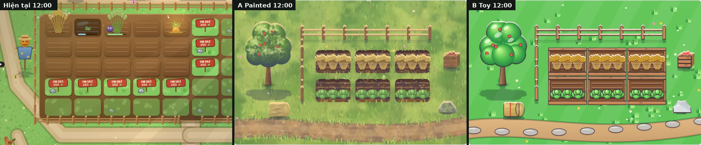
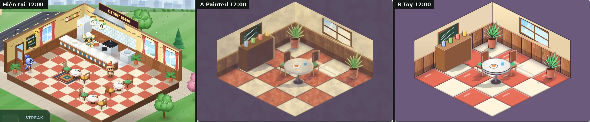
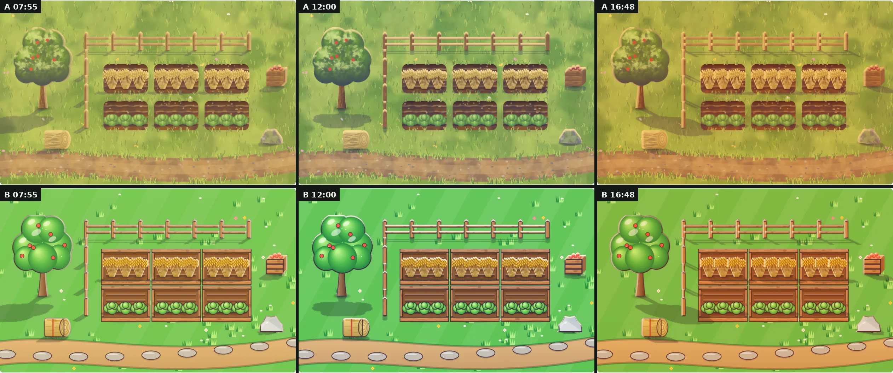
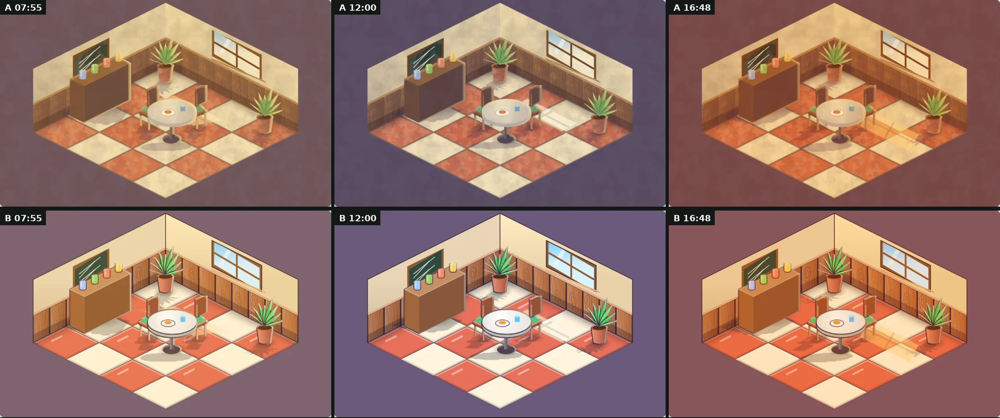

# Nghiên cứu hình ảnh 2D: Plaza, Farm, Bistro

Bản mẫu để chủ game duyệt. **Chưa sửa game** (`apps/` không đổi). Sau khi chọn
hướng sẽ có prompt riêng để áp dụng.

- Trang bản mẫu: [`index.html`](index.html). Mở trực tiếp trong trình duyệt,
  không cần máy chủ, không thư viện (Canvas 2D thuần). Có thanh giờ, mức đồ
  họa Cao/Thấp, ba cách vẽ, và nút "Đo lại trên máy này" để đo trên điện thoại
  thật.
- Ảnh: [`shots/`](shots). Số đo: [`data/`](data). Script đo: [`tools/`](tools).

## Hai hướng, cạnh game hiện tại (12:00)




Theo giờ (07:55, 12:00, 16:48), bóng đổ dùng đúng `sunLight` và `ShadowLayer`
của `apps/client/src/world-light.ts` (chép nguyên, chỉ thêm màu bóng làm tham số):




Mỗi hướng có: vân cỏ, đất, gỗ, đá, gạch; bóng góc (AO) dưới vật và chân tường;
viền sáng phía mặt trời; bóng đổ theo giờ; màu giờ vàng. Bistro có thêm vệt
nắng qua cửa sổ trượt theo giờ (game hiện chưa có bóng theo giờ ở Bistro).

|                          | A · Painted storybook                                                                                   | B · Crisp toy                                                              |
| ------------------------ | ------------------------------------------------------------------------------------------------------- | -------------------------------------------------------------------------- |
| Nét                      | Không viền đen, vệt cọ, hạt giấy nhẹ                                                                    | Viền tối mảnh, cạnh vát sáng, điểm loáng                                   |
| Bóng, sáng               | Bóng ngả tím lạnh, nắng vàng ấm, viền sáng mềm                                                          | Bóng xám xanh như game, viền sáng sắc                                      |
| Ưu                       | "Chân thật", ấm, sâu nhất; hợp hướng painted đã duyệt cho tướng/boss                                    | Bước tiếp của nét hiện tại, áp dụng dần được; dễ đọc trên màn nhỏ; nhẹ hơn |
| Nhược                    | Vân dày dễ thành "bẩn" ở khung nhỏ, che chỗ bấm; phải vẽ lại gần hết; cần hoạ sĩ để đạt chất lượng thật | Ít "chân thật" hơn; màu mạnh dễ chói nếu thiếu màu giờ và AO               |
| Công sức (ước lượng thô) | 32–44 ngày                                                                                              | 21–29 ngày                                                                 |

**Đề xuất:** lấy **B làm gốc** và mượn của A: bóng ngả màu lạnh, nắng ấm và
màu giờ vàng, AO mềm dưới mọi vật. Nếu muốn hẳn cảm giác tranh vẽ, A khả thi
về hiệu năng khi nướng sẵn, nhưng nên có hoạ sĩ làm ô vân và vài vật mẫu trước.
Bản mẫu nhìn gần hơn khung game thường thấy; nên duyệt lại ở đúng mức zoom khi áp dụng.

## Chi phí vẽ

Máy test: container đám mây, 4 nhân Xeon 2,1 GHz, Chromium 153 headless,
**không có GPU** (WebGL báo SwiftShader). Số ms chậm hơn điện thoại thật nhiều
lần; chỉ so **tương đối**. Trung vị 40 frame, mỗi frame đọc 1 điểm ảnh để trình
duyệt vẽ xong thật. Canvas 1440×900 (1,30 triệu điểm ảnh).

| Cảnh                              |   Vẽ trực tiếp | Nướng sẵn (như game) | Nướng cả bóng | Nướng sẵn · Thấp |
| --------------------------------- | -------------: | -------------------: | ------------: | ---------------: |
| Farm A, ms                        |           83,2 |                 14,2 |           8,3 |              7,8 |
| Farm B, ms                        |           38,2 |                 15,2 |           7,7 |              6,5 |
| Bistro A, ms                      |           41,6 |                 15,1 |           9,4 |              7,7 |
| Bistro B, ms                      |           25,7 |                 15,5 |          11,2 |              7,3 |
| Farm drawImage / fill mỗi frame   | 67 / 4 975 (A) |              110 / 2 |       109 / 2 |           43 / 2 |
| Bistro drawImage / fill mỗi frame |   13 / 480 (A) |               20 / 6 |        19 / 6 |            7 / 6 |

- Đồ nướng: Farm 13,2 MB, Bistro 13,7 MB mỗi góc ở 1440×900 (nền 5,2 MB, nền
  kèm bóng thêm 5,2 MB, còn lại sprite và 3 dải viền sáng mỗi sprite). Nướng lần
  đầu 22–62 ms; nướng lại bóng mỗi 5 phút game 6–17 ms.
- Ở 720×450 (0,32 triệu điểm ảnh): nướng sẵn 3,8–4,7 ms, nướng cả bóng 2,3–2,4 ms,
  Thấp 1,6–1,7 ms, vẽ trực tiếp 10–34 ms ([`data/bench-720x450.json`](data/bench-720x450.json)).
- Ô vân 256×256 phủ lên nền (để vân không mờ khi zoom): thêm khoảng 3 ms trên
  1,3 triệu điểm ảnh (5,5 → 8,5 ms), [`tools/detail-texture-bench.cjs`](tools/detail-texture-bench.cjs).
- Game hiện tại, cùng máy và cùng cách đo (844×390 ×2, 12:00):
  Farm trung vị 356 ms/frame, 329 drawImage, khoảng 220 fill/stroke mỗi frame;
  Bistro 164 ms/frame, 16 drawImage, khoảng 540 fill/stroke mỗi frame. **Không so
  thẳng** với bảng trên: game vẽ cả trang trại, thú, thời tiết, nhân vật và đọc
  mọi canvas đang hiện; bản mẫu chỉ là một góc khoảng 70 vật. Đồ nội thất Bistro
  đã được nướng (`bistro-art.ts`, `sprite()`); phần vẽ path mỗi frame đến từ thứ
  khác, bước này chưa tách ra.

## Nướng sẵn được gì

| Phần hình                                       | Cách làm                                                                                                                                  | Lý do                                                                                                                   |
| ----------------------------------------------- | ----------------------------------------------------------------------------------------------------------------------------------------- | ----------------------------------------------------------------------------------------------------------------------- |
| Vân cỏ, đất, gỗ, đá, gạch; AO dưới vật đứng yên | Nướng vào nền (như canvas nền Plaza/Farm hiện nay)                                                                                        | Vẽ trực tiếp vân Painted 83 ms so với 14 ms khi nướng                                                                   |
| Vật đứng yên kèm vân, hạt giấy                  | Sprite nướng (`GFX.sprite`)                                                                                                               | Chỉ thêm chi tiết lúc nướng, không thêm lệnh vẽ mỗi frame                                                               |
| Viền sáng                                       | Nướng vào sprite theo khoảng giờ (vd. 30 phút game), chỉ giữ bản giờ hiện tại                                                             | Bản mẫu vẽ viền riêng: +1–2 drawImage mỗi vật và gấp 4 bộ nhớ sprite. Giờ game theo đồng hồ thật, đổi rất chậm          |
| Bóng đổ vật đứng yên                            | Canvas bóng theo toạ độ thế giới, nửa độ phân giải, vẽ lại mỗi 5 phút game; thú, người chơi, đồ đang kéo vẫn dùng `ShadowLayer` mỗi frame | Frame Farm giảm khoảng 40–50% (14–15 → 8 ms). Ước tính Farm 1240×730 (3,6 MB), Plaza 1350×850 (4,6 MB)                  |
| Vệt nắng cửa sổ, màu giờ vàng                   | Vẽ trực tiếp, tắt ở Thấp                                                                                                                  | Ít lệnh nhưng mỗi lớp phủ toàn màn là một lượt tô cả màn hình                                                           |
| Chi tiết khi zoom                               | Ô vân 256×256 lặp, phủ theo độ phân giải màn                                                                                              | Nền Farm nướng ×1 (2480×1460, 14,5 MB), điện thoại zoom tới 2,4: vân nướng sẵn sẽ mờ. Nền ×2 là 58 MB, không vừa iPhone |
| Thú, nhân vật, cây rung, hiệu ứng               | Không nướng                                                                                                                               | Giữ như hiện nay                                                                                                        |

## Ước lượng công sức (ngày làm, một người cùng AI)

Thô, chưa kiểm chứng; dựa trên lượng mã vẽ hiện có (`farm-gfx.ts` 2 760 dòng,
`crop-art.ts` 1 929, `bistro-art.ts` 2 732, `bistro-furniture.ts` 2 598,
`bistro-scenery.ts` 1 166). Không tính tướng, boss, giao diện.

| Phần việc                                                                                                           |         A |         B |
| ------------------------------------------------------------------------------------------------------------------- | --------: | --------: |
| Nền tảng chung: bộ chất liệu, viền sáng theo giờ, AO, canvas bóng thế giới, ô vân zoom, mức Thấp, test ngân sách vẽ |       5–7 |       4–6 |
| Farm: nền, luống mọi trạng thái, cây trồng mọi giai đoạn, nhà, chuồng, thú                                          |      9–12 |       5–7 |
| Plaza: nền, đài phun, toà nhà, đồ trang trí                                                                         |       6–8 |       4–5 |
| Bistro: các kiểu sàn/tường, nội thất mọi hướng, phố, vệt nắng, bóng theo giờ                                        |      8–11 |       5–7 |
| Đồng bộ, chụp lại test hình, đo máy thật                                                                            |       4–6 |       3–4 |
| **Tổng**                                                                                                            | **32–44** | **21–29** |

## Rủi ro trên máy cũ

- **Tô điểm ảnh:** mỗi lớp phủ toàn màn (màu giờ vàng, ô vân, lớp bóng) là một
  lượt tô cả màn. GPU Android cũ chậm ở đây (`docs/network-performance.md` mục 5
  và 8, cho trận đấu). Ở Thấp tắt hết, chỉ giữ AO đã nướng.
- **Chế độ trộn màu:** bản mẫu dùng `soft-light` và `multiply`; chưa đo trên
  máy thật xem có chậm hơn trộn thường không.
- **Bộ nhớ iPhone:** nền Plaza đã 17,5 MB, nền Farm 14,5 MB; không nướng nền ×2;
  viền sáng phải nướng gộp vào sprite; canvas bóng thêm 3,6–4,6 MB mỗi nơi.
- **Khựng khi nướng:** nướng lần đầu và nướng lại theo giờ nên chia qua
  `requestIdleCallback`.
- **Bóng nướng lệch:** đồ trang trí đang kéo, cổng mở, cây rung phải vẽ trực tiếp
  trong lúc đổi.
- **Chưa có số máy thật:** máy test không có GPU. Trước khi áp dụng, mở
  `index.html` trên một Android cũ và một iPhone, bấm "Đo lại", và xem `?perf=1`.

## Nghiên cứu và nguồn

Mạng của máy làm việc chặn các trang này, nên tôi **không mở được toàn văn**;
các ý lấy từ đoạn trích trên kết quả tìm kiếm.

- **Viền sáng:** hướng dẫn 2D lighting của Unity nói nhân vật thường có viền
  sáng quanh hình để dễ đọc khi di chuyển, nhất là game nhìn từ trên xuống; mask
  chọn chỗ có viền [1]. Thảo luận trên diễn đàn Spine: normal map làm nhân vật
  quá tròn, viền kiểu hoạt hình hợp hơn [2]. Bản mẫu: viền nướng 3 hướng, không
  normal map.
- **Không tô chết sáng tối nếu dùng ánh sáng động:** bài Dragon Crashers của
  Unity [3]. Bản mẫu giữ sáng chính tô sẵn (từ trên, không đổi); chỉ bóng đổ,
  viền sáng, màu giờ đổi theo giờ.
- **AO:** là bóng tiếp xúc nơi các mặt gần nhau (sàn gặp tường, khe) [4]; AO hay
  bóng thời gian thực tốn hiệu năng nên thường nướng sẵn [5].
- **Nướng sẵn trên canvas:** MDN khuyên vẽ trước các thứ lặp lại lên canvas
  ngoài màn hình, làm tròn toạ độ, tách lớp tĩnh/động [6]; web.dev lưu ý lợi
  ích có thể mất vì chép canvas lớn [7].
- **Phong cách:** Hay Day chọn phong cách có chủ ý, "kiểu thập niên 1950" [8][9].
  **Không tìm được nguồn** về cách Hay Day làm hình (vẽ tay hay dựng 3D), nên
  không khẳng định.
- **Sáng ấm, bóng lạnh (hue shift):** **chưa xác minh bằng nguồn** trong bước
  này; là kinh nghiệm vẽ tranh phổ biến.

1. [Unity: 2D light and shadow techniques with the Universal Render Pipeline](https://discussions.unity.com/t/2d-light-and-shadow-techniques-with-the-universal-render-pipeline/1641848)
2. [Esoteric Software (Spine) forum, thread 11836](https://en.esotericsoftware.com/forum/d/11836)
3. [Unity Blog: 2D art creation in Dragon Crashers](https://blog.unity.com/en/games/2d-art-creation-in-dragon-crashers)
4. [80.lv: The VFX map baking guide, ambient occlusion](https://80.lv/articles/the-vfx-map-baking-guide-ambient-occlusion)
5. [ViewAR SDK docs: Ambient Occlusion maps](https://viewar.gitbooks.io/sdk-documentation/3d-content/3d-content--custom-models/guidelines/guidelines-AO/00--3d-content--custom-models--guidelines--AO--overview.html)
6. [MDN: Optimizing canvas](https://developer.mozilla.org/en-US/docs/Web/API/Canvas_API/Tutorial/Optimizing_canvas)
7. [web.dev: Improving HTML5 Canvas performance](https://web.dev/articles/canvas-performance)
8. [PocketGamer.biz: Supercell looking back at 10 years of Hay Day, part one](https://www.pocketgamer.biz/supercell-looking-back-10-years-of-hay-day-part-one)
9. [MobileGamer.biz: What Supercell's Hay Day team learned from ten years of updates](https://mobilegamer.biz/what-supercells-hay-day-team-learned-from-ten-years-of-updates/)

## Chạy lại phép đo

```bash
NODE_PATH=$(npm root) node docs/visual-study/tools/render-prototype.cjs /tmp/out bench 1 3
```

Ảnh game hiện tại: chép `tools/capture-current.spec.ts` vào `tests/visual/`,
chạy như ghi trong đầu file, rồi xoá bản chép.
